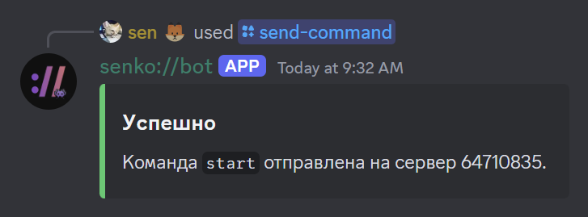

# Sending Commands

With the bot, you can send commands to your server from Discord.

To use this command, you must first [authorize with the Discord bot](/bot/auth).

To use the command, simply follow the syntax we've provided and everything will work.

Example for a running Garry's Mod server (replace the ID with yours from `/servers-list`):

```text
/send-command server_id: 64710835 command: status
```

{data-zoomable}

This sends a command to the game console. It does not start a stopped server; use the panel's power controls for that.
