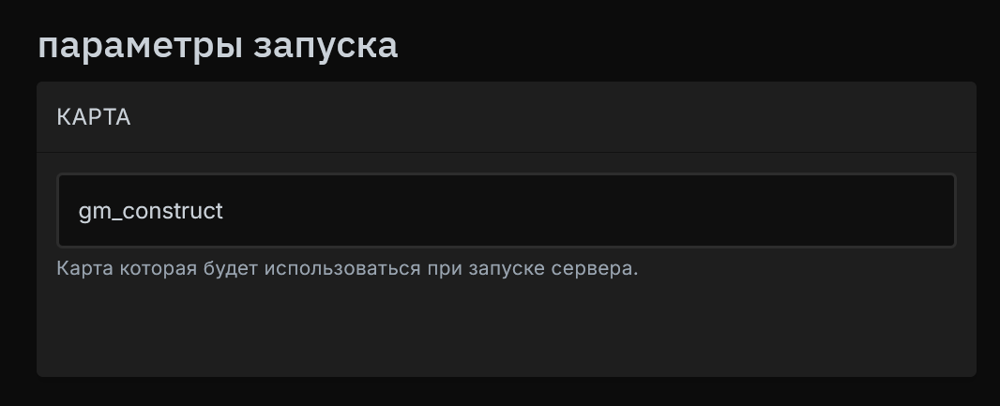

# <GmodLogo>Changing The Startup Map</GmodLogo>

A quick guide to changing the default map on your Garry's Mod game server.

## Setting a Variable in Startup Parameters

Go to the management page of your server.

Navigate to the server startup parameters and find the "Map" parameter.

Enter the full name of the map, for example `gm_construct`.

{data-zoomable}

Done! Now the server will load with this map every time it starts.

## Listing available maps on the server

If you are unsure which maps you have installed on the server, you can easily find out the full list (including Workshop addons) by using the `maps *` command through the Console.

{data-zoomable}

## Installing Maps from Steam Workshop

Add the map to the server's [Workshop collection](/games/gmod/workshop). Start with a built-in map such as `gm_construct`, wait for the collection to finish downloading, and check the console for errors. Run `maps *` to find the installed map's name, then enter that name without `.bsp` in the startup parameters and restart.

If the map still cannot be loaded at startup, check its Workshop page for required content. If the author provides a direct `.bsp` download, upload it to `/garrysmod/maps/` and use its filename without the extension.
