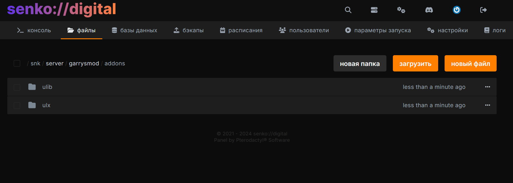
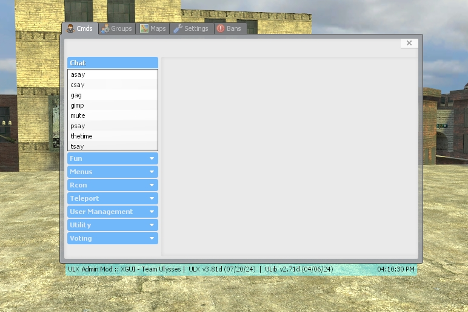

# <GmodLogo>Installing and Configuring ULX</GmodLogo>

Quick guide to installing and configuring the **ULX** admin system on your Garry's Mod server.

## Introduction

**ULX** is a powerful administrative system for Garry's Mod servers that provides a wide range of server management capabilities.

In this guide, we'll cover the process of downloading and installing **ULX** and **ULib**, granting superadmin rights, and using the ULX interface.

## Downloading the Addons

First, you need to download **ULX** and **ULib** to your PC.

[**[Download ULib](https://github.com/TeamUlysses/ulib/archive/refs/heads/master.zip)**]

[**[Download ULX](https://github.com/TeamUlysses/ulx/archive/refs/heads/master.zip)**]

## Installing on the Server

1. Upload both archives to the `/garrysmod/addons/` path using the file manager in the control panel.
2. Right-click on the **ULib** archive, select the "extract" option. Delete the archive after extraction is complete. For convenience, you can rename the new folder to `ulib`, removing the `-master` suffix.
3. Extract the **ULX** archive, delete the archive after extraction, and also rename the folder to `ulx`, removing the `-master` suffix.

{data-zoomable}

Restart the server to load **ULX** and **ULib** before running the commands below.

::: tip
The links are safe and point to the official GitHub repository from the original addon developer - **Team Ulysses**.
:::

## Initial ULX Setup

After installing **ULX** and **ULib**, you need to perform the initial setup of administrator privileges.

### Granting Superadmin Rights

By default, the list of superadmins and admins is empty. Let's fix that!

#### Granting Rights via Nickname

Go to your game server console and grant yourself superadmin rights using the command:

```
ulx adduser "nickname" superadmin
```

where `nickname` is your Steam nickname. You must be connected to the game server for this command; keep the quotes if your name contains spaces. Run it in the hosting panel console.

#### Granting Rights via SteamID

If your nickname is difficult to type, or you don't want to join the server to grant rights, you can also grant yourself superadmin rights using your SteamID.

You can get it using the website [steamid.xyz](https://steamid.xyz/)

Example command execution:

```lua
ulx adduserid STEAM_0:1:7099 superadmin
```

### Opening the Menu

In the game itself, you can use the ULX management menu - this is where administrator and regular user rights are configured, as well as various commands are executed.

You can open the menu using the console command (in the game):

```lua
ulx menu
```

#### Assigning a Key to Open the Menu

For more convenient menu access, you can also assign it to any key that works for you.

This is done using the following command:

```lua
bind [key] "ulx menu"
```

For example:

```lua
bind m "ulx menu"
```

Done! Now the menu will open without using extra console commands.

{data-zoomable}

Now you can proceed with further ULX configuration without unnecessary hassle.

## ULX Console Commands

Use `ulx help` to see the commands available to you on your server.

`<Arguments>` are required; `[arguments]` are optional. Leave out the brackets and replace `Sen`, `Katie` and the example SteamID with your players' details. Put names containing spaces in quotes.

Run commands in the hosting panel console or the game console with the necessary permissions. Use the game console for menus, spectating, `bring`, `goto`, `teleport`, `jailtp` and `ent`. If you leave out an optional `[player]`, the command targets you.

Commands with multiple targets accept `*` for everyone, `^` for yourself, or nicknames separated by commas.

### Fun Commands

| Command | Example | Description |
| --- | --- | --- |
| `ulx armor <player> <armor>` | `ulx armor Sen 100` | Sets armor from 0 to 255. |
| `ulx blind <player> [amount]` | `ulx blind Sen 255` | Darkens the player's screen by 0–255. Defaults to 255, a completely black screen. |
| `ulx unblind <player>` | `ulx unblind Sen` | Removes the screen darkening. |
| `ulx cloak [player] [amount]` | `ulx cloak Sen 255` | Makes the player invisible. The amount ranges from 0 to 255; the default of 255 gives full invisibility. |
| `ulx uncloak [player]` | `ulx uncloak Sen` | Makes the player visible again. |
| `ulx freeze <player>` | `ulx freeze Sen` | Freezes the player in place. |
| `ulx unfreeze <player>` | `ulx unfreeze Sen` | Unfreezes the player. |
| `ulx god [player]` | `ulx god Sen` | Enables god mode. |
| `ulx ungod [player]` | `ulx ungod Sen` | Disables god mode. |
| `ulx hp <player> <health>` | `ulx hp Sen 100` | Sets health to 1 or more. |
| `ulx ignite <player> [seconds]` | `ulx ignite Sen 10` | Sets the player on fire for 1–300 seconds. Defaults to 300 seconds. |
| `ulx unignite <player>` | `ulx unignite Sen` | Extinguishes the selected player. |
| `ulx unigniteall` | `ulx unigniteall` | Extinguishes all players and burning entities on the server. |
| `ulx jail <player> [seconds]` | `ulx jail Sen 60` | Jails the player for the given number of seconds. With no duration or with 0, lasts until `ulx unjail`. |
| `ulx unjail <player>` | `ulx unjail Sen` | Releases the player from the cage. |
| `ulx jailtp <player> [seconds]` | `ulx jailtp Sen 60` | Teleports the player where you are looking and jails them. Duration is in seconds, as with `ulx jail`. |
| `ulx maul <player>` | `ulx maul Sen` | Sets fast zombies on the player. |
| `ulx playsound <sound>` | `ulx playsound buttons/button14.wav` | Plays a sound for everyone. Use a path relative to `sound/`. |
| `ulx ragdoll <player>` | `ulx ragdoll Sen` | Turns the player into a ragdoll. |
| `ulx unragdoll <player>` | `ulx unragdoll Sen` | Turns the ragdoll back into a player. |
| `ulx slap <player> [damage]` | `ulx slap Sen 5` | Knocks the player around and deals the specified damage. Damage defaults to 0. |
| `ulx whip <player> [count] [damage]` | `ulx whip Sen 5 2` | Repeats `slap` between 2 and 100 times. Defaults to 10 times with no damage. |
| `ulx slay <player>` | `ulx slay Sen` | Kills the selected player. |
| `ulx sslay <player>` | `ulx sslay Sen` | Kills the player without the usual death effects. |
| `ulx strip <player>` | `ulx strip Sen` | Removes the player's weapons. |

### Console Commands and Lua

| Command | Example | Description |
| --- | --- | --- |
| `ulx cexec <player> <command>` | `ulx cexec Sen "say Hello"` | Runs a command in the player's console, if the game allows it to run remotely. |
| `ulx luarun <code>` | `ulx luarun =game.GetMap()` | Runs Lua on the server. Use `=` before an expression to print its result. |
| `ulx rcon <command>` | `ulx rcon status` | Runs a command in the server console. |
| `ulx exec <file>` | `ulx exec server.cfg` | Runs a configuration file from `garrysmod/cfg/`. |
| `ulx ent <class> [parameters]` | `ulx ent prop_physics model:models/props_c17/oildrum001.mdl` | Spawns an entity where you are looking. Parameters use `key:value`, separated by `\|`. |

### Groups and Permissions

Use the full command name in quotes: `"ulx kick"`. Access tags limit arguments, such as the maximum damage. See `ulx usermanagementhelp` for details.

| Command | Example | Description |
| --- | --- | --- |
| `ulx addgroup <group> [parent]` | `ulx addgroup moderator user` | Creates a group with inherited permissions. Inherits from `user` by default. |
| `ulx adduser <player> <group>` | `ulx adduser Sen moderator` | Adds an online player to an existing group. |
| `ulx adduserid <ID> <group>` | `ulx adduserid STEAM_0:1:123456 moderator` | Assigns a group by SteamID, IP or UniqueID. The player does not need to be online. |
| `ulx groupallow <group> <command> [access_tag]` | `ulx groupallow moderator "ulx kick"` | Gives a group access to a command. |
| `ulx groupdeny <group> <command>` | `ulx groupdeny moderator "ulx kick"` | Removes a permission from the group. Inherited permissions still apply. |
| `ulx removegroup <group>` | `ulx removegroup moderator` | Deletes a group. |
| `ulx removeuser <player>` | `ulx removeuser Sen` | Deletes the player's record, including their group and personal permissions. |
| `ulx removeuserid <ID>` | `ulx removeuserid STEAM_0:1:123456` | Deletes a player record by SteamID, IP or UniqueID. |
| `ulx renamegroup <group> <new_name>` | `ulx renamegroup moderator helper` | Renames an existing group. |
| `ulx setgroupcantarget <group> [targets]` | `ulx setgroupcantarget moderator "!%admin"` | Limits who the group can target. The example excludes admins and higher ranks. Omit the second argument to remove the limit. |
| `ulx userallow <player> <command> [access_tag]` | `ulx userallow Sen "ulx slap" "* 0:10"` | Gives a player access to a command. The example allows `slap` with 0–10 damage. |
| `ulx userallowid <ID> <command> [access_tag]` | `ulx userallowid STEAM_0:1:123456 "ulx kick"` | Grants command access by SteamID, IP or UniqueID. |
| `ulx userdeny <player> <command> [revoke]` | `ulx userdeny Sen "ulx kick"` | Blocks a command even if the group allows it. Add `1` to clear the personal rule and use the group's permissions. |
| `ulx userdenyid <ID> <command> [revoke]` | `ulx userdenyid STEAM_0:1:123456 "ulx kick"` | Works like `ulx userdeny`, but accepts a SteamID, IP or UniqueID. |
| `ulx usermanagementhelp` | `ulx usermanagementhelp` | Shows help on groups and permissions. |

### Player and Map Management

| Command | Example | Description |
| --- | --- | --- |
| `ulx ban <player> [minutes] [reason]` | `ulx ban Sen 60 "Repeated spam"` | Bans the player for the given number of minutes. With no duration or with 0, the ban is permanent. |
| `ulx banid <SteamID> [minutes] [reason]` | `ulx banid STEAM_0:1:123456 60 "Repeated spam"` | Bans by SteamID, including offline players. Duration is in minutes, as with `ulx ban`. |
| `ulx unban <SteamID>` | `ulx unban STEAM_0:1:123456` | Unbans a SteamID. |
| `ulx kick <player> [reason]` | `ulx kick Sen "Please change your nickname"` | Kicks the player with the given reason. |
| `ulx map <map> [gamemode]` | `ulx map gm_construct sandbox` | Changes the map. The second argument sets the gamemode. |
| `ulx noclip [player]` | `ulx noclip Sen` | Toggles free flight through objects. |
| `ulx spectate <player>` | `ulx spectate Sen` | Lets you spectate the player. |
| `ulx who [SteamID]` | `ulx who` | Lists online players and their groups. Add a SteamID to look up one player. |

### Utility Commands

| Command | Example | Description |
| --- | --- | --- |
| `ulx help` | `ulx help` | Lists your available commands and their arguments. |
| `ulx version` | `ulx version` | Displays the installed ULX and ULib versions. |
| `ulx debuginfo` | `ulx debuginfo` | Outputs server, player and settings information for troubleshooting. |
| `ulx resettodefaults [FORCE]` | `ulx resettodefaults` | Resets ULX and ULib, including groups, permissions and bans. Add `FORCE` to confirm, then change the map. |

### Chat Management

| Command | Example | Description |
| --- | --- | --- |
| `ulx asay <message>` | `ulx asay "Please check the spawn area"` | Sends a message to the admins currently online. |
| `ulx csay <message>` | `ulx csay "Restart in 5 minutes"` | Displays a message in the center of every player's screen. |
| `ulx tsay <message>` | `ulx tsay "Please read the server rules"` | Sends a message to everyone in text chat. |
| `ulx psay <player> <message>` | `ulx psay Sen "Please contact an admin"` | Sends a private message to a player. |
| `ulx gag <player>` | `ulx gag Sen` | Disables voice chat for the player. |
| `ulx ungag <player>` | `ulx ungag Sen` | Re-enables voice chat. |
| `ulx mute <player>` | `ulx mute Sen` | Disables text chat for the player. |
| `ulx unmute <player>` | `ulx unmute Sen` | Re-enables text chat. |
| `ulx gimp <player>` | `ulx gimp Sen` | Replaces the player's messages with phrases from the ULX list. |
| `ulx ungimp <player>` | `ulx ungimp Sen` | Stops replacing the player's messages. |
| `ulx thetime` | `ulx thetime` | Shows the current server time. |

### Voting

| Command | Example | Description |
| --- | --- | --- |
| `ulx vote <question> <option1> <option2> [more_options]` | `ulx vote "Change the map?" "Yes" "No"` | Starts a vote with 2–10 answer options. |
| `ulx stopvote` | `ulx stopvote` | Stops the current vote. |
| `ulx voteban <player> [minutes] [reason]` | `ulx voteban Sen 60 "Repeated spam"` | Starts a ban vote. Duration is in minutes: 1440 (one day) by default, or 0 for a permanent ban. |
| `ulx votekick <player> [reason]` | `ulx votekick Sen "Repeated spam"` | Starts a vote to kick the player. |
| `ulx votemap [map]` | `ulx votemap gm_construct` | Votes for a map. Without an argument, lists available maps. The map changes when enough votes are cast. |
| `ulx votemap2 <map> [more_maps]` | `ulx votemap2 gm_construct gm_flatgrass` | Starts a map vote with 1–10 maps. |
| `ulx veto` | `ulx veto` | Cancels the map change following a successful `ulx votemap`. |

### Teleportation

| Command | Example | Description |
| --- | --- | --- |
| `ulx bring <player>` | `ulx bring Sen` | Teleports the player to you. |
| `ulx goto <player>` | `ulx goto Sen` | Teleports you to the player. |
| `ulx return [player]` | `ulx return Sen` | Returns the player to their position before the teleport. |
| `ulx send <player> <destination_player>` | `ulx send Sen Katie` | Teleports the first player to the second. |
| `ulx teleport [player]` | `ulx teleport Sen` | Teleports the player where you are looking. |

### Menus

Run these commands in the game console.

| Command | Example | Description |
| --- | --- | --- |
| `ulx motd` | `ulx motd` | Opens the MOTD welcome window. |
| `ulx menu` | `ulx menu` | Opens or closes the XGUI menu. |
| `xgui [action]` | `xgui show` | Controls XGUI: `show` opens it, `hide` closes it, and `toggle` switches its state. |
| `xgui fban <player>` | `xgui fban Sen` | Freezes the player and opens the ban window with their details. |
| `xgui xban [player]` | `xgui xban Sen` | Opens the ban window. Fills in player details if a name is given. |
