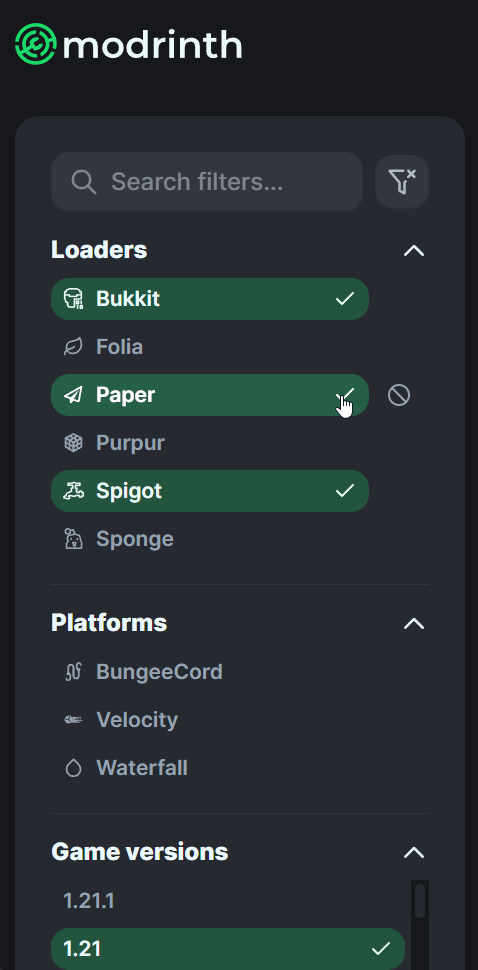
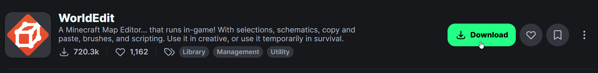
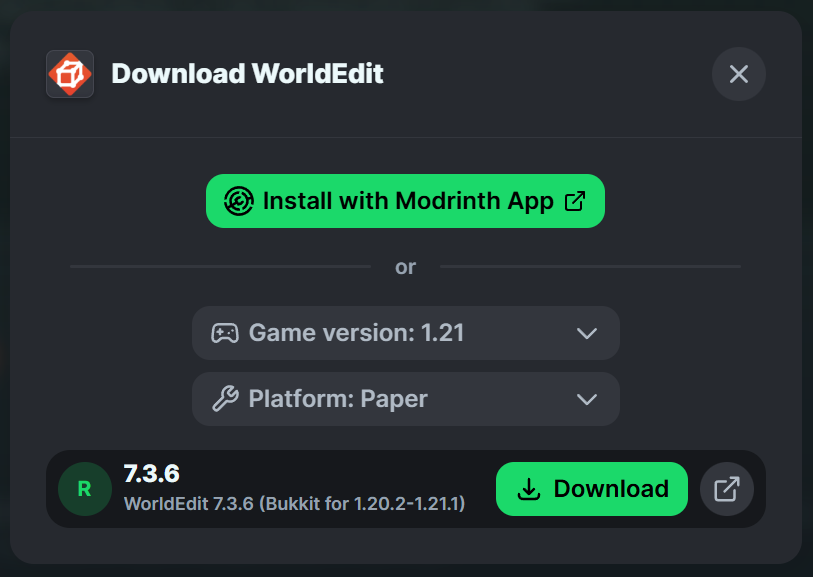
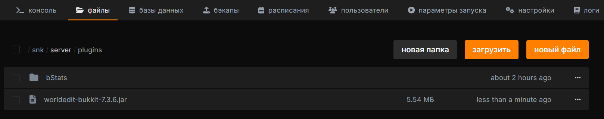
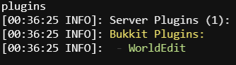

# <MinecraftLogo>Installing Plugins</MinecraftLogo>

A quick guide to installing plugins on your Minecraft server.

***

::: tip
These instructions are for Bukkit/Spigot plugins on compatible servers such as [Paper](https://papermc.io/). Fabric and Forge use mods, usually installed in the `mods` folder. See our [server software guide](/games/minecraft/software) before choosing a download.
:::

Paper supports Bukkit and Spigot plugins. Plugins that use Paper-only features will not work on CraftBukkit or Spigot. Check the supported server software, Minecraft version, Java version, and required dependencies on the plugin's page. See the [Paper plugin guide](https://docs.papermc.io/paper/adding-plugins/).

Download plugins from their developers or trusted platforms such as [Hangar](https://hangar.papermc.io/), [Bukkit](https://dev.bukkit.org/bukkit-plugins), [Spigot Resources](https://www.spigotmc.org/resources/), and [Modrinth](https://modrinth.com/plugins).

### Downloading Plugins

In this tutorial, we'll use [Modrinth](https://modrinth.com/plugins) as an example because of its simplicity and the wide range of plugins available.

Filtering by server type (platform/core) and game version is highly recommended to ensure compatibility.

{data-zoomable}

Once you've found your desired plugin, open its page and click the "Download" button.

{data-zoomable}

A popup will prompt you to pick the version and core (platform). Choose the ones that match your server setup.

{data-zoomable}

### Installing the Plugin on the Server

Stop the server before installing or replacing a plugin. After downloading the plugin, access your server's file manager and open the `plugins` directory. Upload the downloaded `.jar` file here (for example, `worldedit-bukkit-7.3.6.jar`).

{data-zoomable}

### Testing That the Plugin Works

Restart your Minecraft server to load the new plugin. Once the server is running, type the `plugins` command in the server console. Check that the plugin is enabled, not just listed. If it appears in red or fails to load, check the startup console for missing dependencies or version errors.

{data-zoomable}
