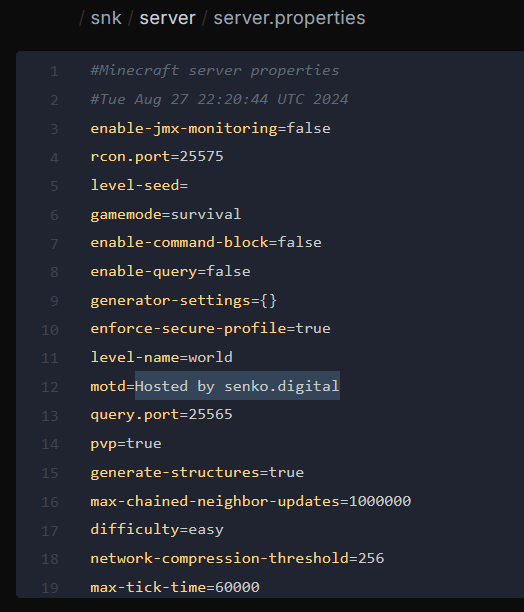
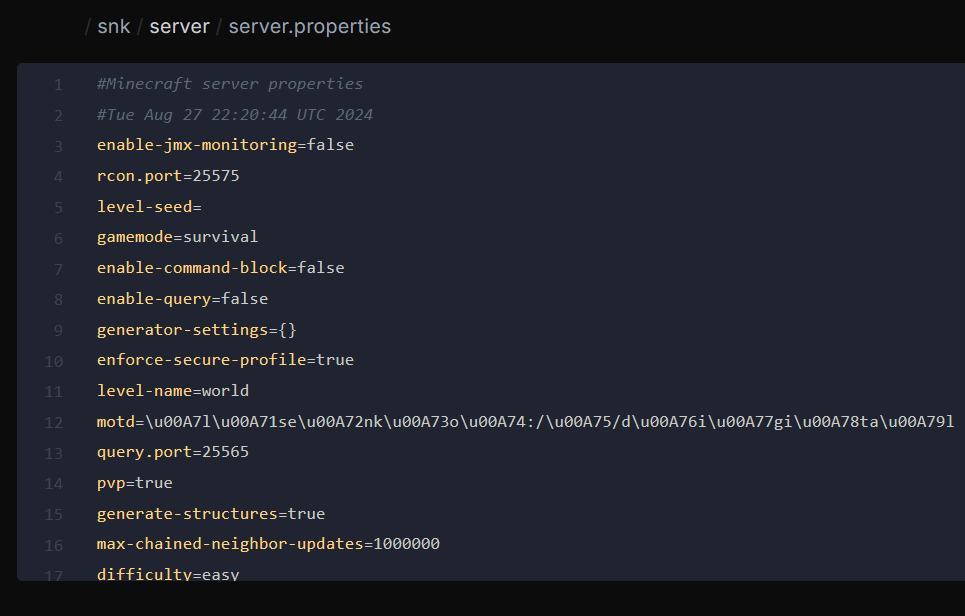
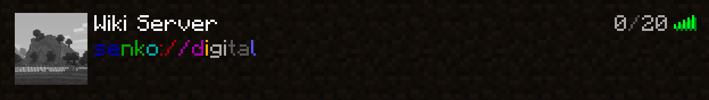

# <MinecraftLogo>Changing Server MOTD</MinecraftLogo>

Quick guide for changing a Minecraft server MOTD in the game control panel.

***

::: tip
For generating a beautiful MOTD, we recommend using **[MCTools](https://mctools.org/motd-creator)**
:::

Go to the management of the server you need.

Enter the file manager and open the `server.properties` file.

{data-zoomable}

Stop the server and replace the value after `motd=` with your new text. You can generate formatting with the service above. This changes the description shown in the multiplayer list, not the name players save locally.

{data-zoomable}

Save the file, start the server, and refresh the multiplayer list. Now your server's name will truly sparkle :sparkles:

{data-zoomable}
