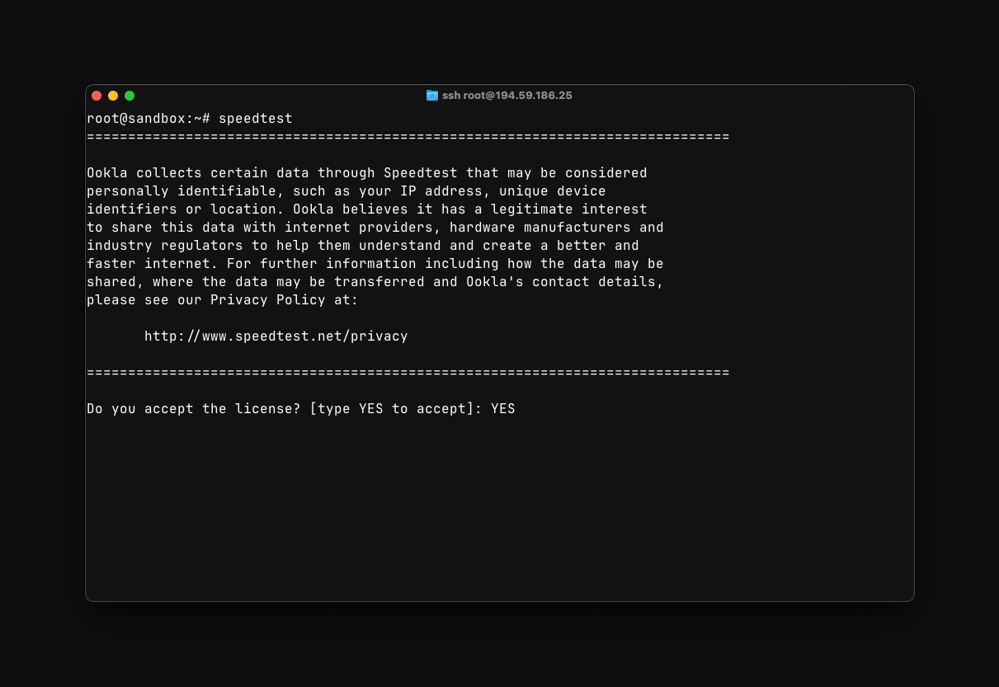
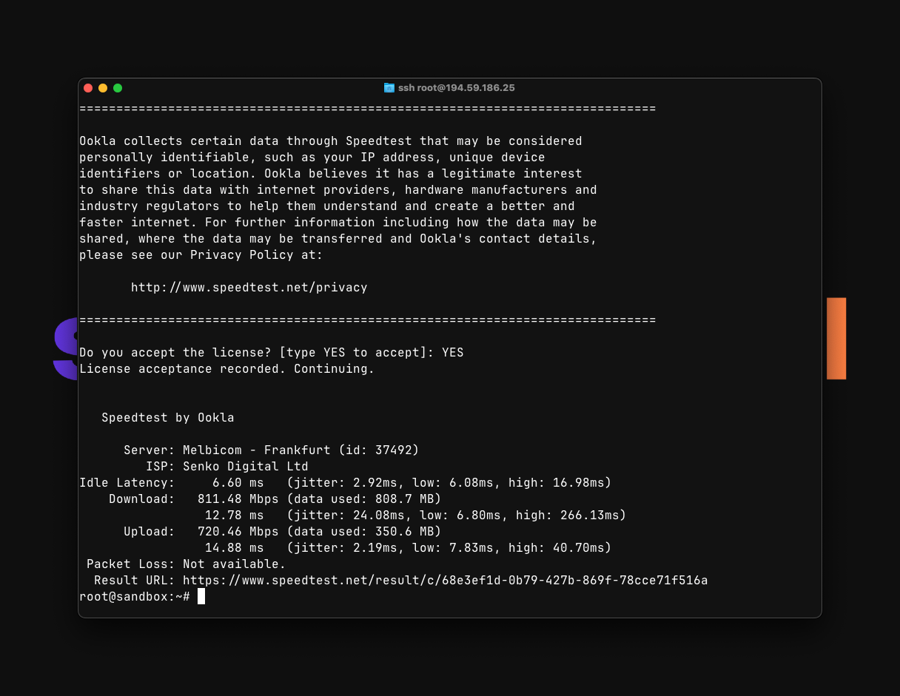

# Server Speed Testing

Speedtest CLI is the official utility from Ookla for testing connection speed through your server's command line.

This guide will help you install and use Speedtest CLI on various operating systems.

## Installation

Choose instructions for your OS version from the [official Speedtest CLI page](https://www.speedtest.net/apps/cli). On FreeBSD, install only a package that matches your FreeBSD version.

::: tip Ubuntu 24.04, Ubuntu 26.04 and Debian 13
Debian 13 (Trixie) has packages in Ookla's repository and does not need an override.

Ubuntu 24.04 (Noble) and Ubuntu 26.04 (Resolute) do not currently have packages in the repository. On these versions, replace the repository installation command below with this command to use Ookla's Ubuntu 22.04 (Jammy) repository:

```bash
curl -fsSL https://packagecloud.io/install/repositories/ookla/speedtest-cli/script.deb.sh | sudo env os=ubuntu dist=jammy bash
```

This changes only the Ookla repository, not your system's Ubuntu repositories. Then continue with `sudo apt-get update` and `sudo apt-get install speedtest`.
:::

::: code-group

```bash [Ubuntu/Debian]
# Installing sudo if not already installed
apt install sudo -y

# Removing unofficial versions of Speedtest CLI
sudo apt-get remove speedtest
sudo apt-get remove speedtest-cli

# Speedtest CLI repository installation
sudo apt-get install curl
curl -fsSL https://packagecloud.io/install/repositories/ookla/speedtest-cli/script.deb.sh | sudo bash

# Speedtest CLI installation
sudo apt-get update
sudo apt-get install speedtest
```

```bash [Fedora/CentOS/RedHat]
# Removing unofficial versions of Speedtest CLI
sudo yum remove speedtest

# Installing Speedtest CLI
curl -s https://packagecloud.io/install/repositories/ookla/speedtest-cli/script.rpm.sh | sudo bash
sudo yum install speedtest
```


:::

## Usage

To run a speed test, execute the command:

```bash
speedtest
```

When starting the utility for the first time, you need to accept the license agreement and [privacy policy](https://www.speedtest.net/privacy):

{data-zoomable}

To accept the terms, type `YES` and press `[Enter]`

After accepting the terms, the utility will automatically start testing the network speed:

{data-zoomable}

Upon completing the test, the utility will generate a link to the test results, which you can use to send to support or share with friends.

---

To select a specific server, use:

```bash
speedtest --server-id=1234
```

where `1234` is the Speedtest server ID

---

To view a list of available servers, use the command:

```bash
speedtest --servers
```

## Additional Parameters

### Basic Parameters

- `-h, --help` - display help
- `-v` - verbosity level (can be specified multiple times, e.g. `-vvv`)
- `-V, --version` - display utility version
- `-L, --servers` - display list of nearest servers
- `--selection-details` - display server selection details
- `-s id, --server-id=id` - specify a particular server by ID
- `-o hostname, --host=hostname` - specify server by hostname
- `-f format_type, --format=format_type` - output format (default `human-readable`)
- `--progress=yes|no` - enable/disable progress indicator
- `-I interface, --interface=interface` - bind to a specific network interface
- `-i ip_address, --ip=ip_address` - bind to a specific IP address
- `--ca-certificate=path` - path to CA certificate

### Output Formats

- `human-readable` - human-readable format (default)
- `csv` - comma-separated values
- `tsv` - tab-separated values
- `json` - JavaScript Object Notation (compact)
- `jsonl` - JavaScript Object Notation (line-oriented)
- `json-pretty` - JavaScript Object Notation (formatted)

### Speed Measurement Units

#### Decimal Units
- `bps` - bits per second
- `kbps` - kilobits per second
- `Mbps` - megabits per second
- `Gbps` - gigabits per second
- `B/s` - bytes per second
- `kB/s` - kilobytes per second
- `MB/s` - megabytes per second
- `GB/s` - gigabytes per second

#### Binary Units
- `kibps` - kibibits per second
- `Mibps` - mebibits per second
- `Gibps` - gibibits per second
- `kiB/s` - kibibytes per second
- `MiB/s` - mebibytes per second
- `GiB/s` - gibibytes per second

### Abbreviations for Measurement Units

- `-a` - abbreviation for `-u auto-decimal-bits`
- `-A` - abbreviation for `-u auto-decimal-bytes`
- `-b` - abbreviation for `-u auto-binary-bits`
- `-B` - abbreviation for `-u auto-binary-bytes`

## Usage Examples

```bash
# Basic speed test to the nearest server, auto-selected
speedtest
```

```bash
# Speed test with server selection and JSON output
speedtest --server-id=1234 --format=json
```

```bash
# Speed test with progress indicator disabled
speedtest --progress=no
```

```bash
# Speed test with output in megabytes per second
speedtest --unit=MB/s
```

```bash
# Speed test with binding to a specific network interface
speedtest --interface=eth0
```
