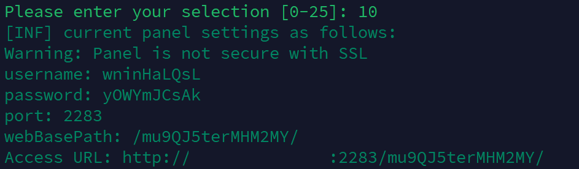
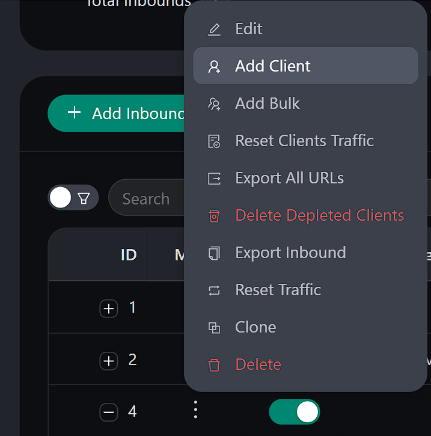
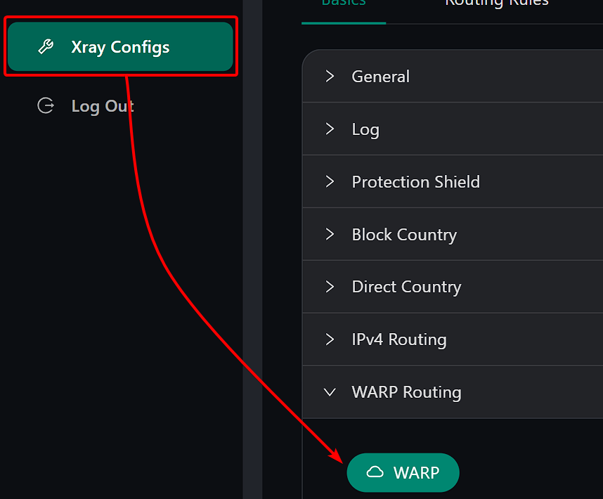

# Installation and Usage Guide for 3X-UI Panel

<p align="center">
  <picture>
    <source media="(prefers-color-scheme: dark)" srcset="/images/vpn/3x-ui/x-ui.png">
    
  </picture>
</p>

3X-UI is a web panel for configuring a VPN server. It supports VMess, VLESS, Trojan, ShadowSocks, and WireGuard.

You can create connections, add users, set traffic and IP address limits, and choose when access expires.

<!-- ::: tip 
Our hosting clients have access to fully automated 3X-UI panel installation script during initial service ordering, or through scripts in the VM control panel. All that remains is to create users and configure inbounds.
::: -->

## 3x-ui Features

- Multilingual interface (English, Persian, Chinese, Russian, Vietnamese, Spanish)
- Support for multiple protocols (VMess, VLESS, Trojan, ShadowSocks, WireGuard)
- Multiple user management
- Setting limits for traffic, expiration dates, and IP addresses
- Automatic SSL certificate management
- Intuitive web interface
- Traffic usage statistics
- Ad blocking and traffic routing capabilities
- Support for Reality technology to bypass restrictions

## Installation

<!-- ### Automatic Installation for Hosting Clients

#### During Service Order

In the order menu, select "3X-UI" from the dropdown menu, complete the order and wait for service processing to finish.

Immediately after server activation, you will receive login credentials for both the server OS and 3X-UI panel. After that, you can [log in](/vpn/3x-ui#logging-into-the-web-panel) and start [configuring connections](/vpn/3x-ui#setting-up-connections-inbounds).

#### Through the VM Panel

Go to the [VM control panel](https://vm.senko.digital), navigate to the management of the desired server, expand the "Menu" in the top right corner and select "Run script".

In the dialog, select the "3X-UI" option and enable "Send email associated with script".

After installation is complete, you will receive an email with login credentials for the control panel. Then you can [log in](/vpn/3x-ui#logging-into-the-web-panel) and start [configuring connections](/vpn/3x-ui#setting-up-connections-inbounds). -->

### Standard Installation

Connect to your VPS over SSH as root, or run `sudo -i` first. On Ubuntu or Debian, install `curl` before running the installer:

```bash
apt update
apt install -y curl
```

Then install 3X-UI:

```bash
bash <(curl -Ls https://raw.githubusercontent.com/mhsanaei/3x-ui/master/install.sh)
```

During installation, you will be prompted to:

1. Choose the database type (for personal use, SQLite is recommended).

2. Change panel settings (recommended to answer `y` for increased security).

3. Specify the panel port (recommended to use a non-standard port).

4. Create an SSL certificate for a domain or IP address (recommended to create at least for the IP address, option 2).


### Installing a Specific Version

To install a specific version, set the `VERSION` variable to the version you want. For example, for version v1.7.9:

```bash
VERSION=v1.7.9 && bash <(curl -Ls "https://raw.githubusercontent.com/mhsanaei/3x-ui/$VERSION/install.sh") $VERSION
```

This is only an example of the version syntax. Version `v1.7.9` is old; use a current release for the REALITY and XHTTP instructions below.

### Docker Installation

1. Install Docker:

```bash
bash <(curl -sSL https://get.docker.com)
```

2. Create a directory for the panel and its persistent data:

```bash
mkdir -p 3x-ui
cd 3x-ui
```

3. Create `compose.yaml` in this directory with the following contents. This uses the published image and host networking, so Xray can reach Nginx on the VPS at `127.0.0.1:8443`:

```yaml
services:
  3x-ui:
    image: ghcr.io/mhsanaei/3x-ui:latest
    container_name: 3x-ui
    network_mode: host
    restart: unless-stopped
    cap_add:
      - NET_ADMIN
      - NET_RAW
    volumes:
      - ./db:/etc/x-ui
      - ./cert:/root/cert
      - ./acme:/root/.acme.sh
```

4. Start the panel:

```bash
docker compose up -d
```

Or alternatively:

```bash
docker run -itd \
   -e XRAY_VMESS_AEAD_FORCED=false \
   -v $PWD/db/:/etc/x-ui/ \
   -v $PWD/cert/:/root/cert/ \
   -v $PWD/acme/:/root/.acme.sh/ \
   --cap-add=NET_ADMIN --cap-add=NET_RAW \
   --network=host \
   --restart=unless-stopped \
   --name 3x-ui \
   ghcr.io/mhsanaei/3x-ui:latest
```

Use only one of these methods. Keep the `db`, `cert`, and `acme` directories when updating or recreating the container.

On the first start, the container generates a username and password and prints them in its logs. View and save them:

```bash
docker logs 3x-ui
docker exec 3x-ui /app/x-ui setting -show
```

The second command shows the panel port and URL path. A fresh container initially uses HTTP. For private access while setting up HTTPS, run `ssh -L 18053:127.0.0.1:2053 root@YOUR_SERVER_IP` on your computer, keep that SSH session open, and open `http://127.0.0.1:18053/` in your browser. Replace `2053` and append the panel path if your settings differ. After configuring the domain certificate below, use the panel's HTTPS address.

## SSL Certificate Configuration

You can configure an SSL certificate in 3X-UI in several ways.

### ACME

**To manage SSL certificates using ACME:**

1. Make sure your domain correctly points to this server (i.e., the A record in DNS is configured correctly).
2. Run the `x-ui` command in the terminal, then select `SSL Certificate Management` (option 19).
3. You will be presented with the following options:
    - **Get SSL (Domain):** Obtain an SSL certificate for a domain.
    - **Revoke:** Revoke existing SSL certificates.
    - **Force Renewal:** Force renewal of SSL certificates.
    - **Show Existing Domains:** Display all domain certificates available on the server.
    - **Specify Certificate Paths for the Panel:** Specify a certificate for your domain to be used by the control panel.
    - **Get SSL Certificate for IP Address:** Obtain an SSL certificate for the IP address.

### Certbot

**To install and use Certbot, simply enter these commands:**

For the self-SNI website, use [step 3 of the self-SNI instructions](#_3-enable-https-for-the-website) instead. The standalone example below is for a server where port `80` is free; it cannot run while Nginx is using that port.

```bash
apt-get install certbot -y
certbot certonly --standalone --agree-tos --register-unsafely-without-email -d yourdomain.com
certbot renew --dry-run
```

- where `yourdomain.com` is your domain

::: warning
This example requests a domain certificate. Keep TCP port `80` reachable and available for standalone certificate renewal. Do not combine this renewal method with the Nginx setup below; that setup uses Certbot's webroot method.
:::

## Logging into the Web Panel

After installation, save the panel address, username, and password in a safe place.
If the installation was successful, you will be provided with login data in this format:


<!-- follow the instructions below: -->

<!-- 1. Enter the command `x-ui`
2. Select option `10` by entering the corresponding number in the terminal.

You will be provided with login data in this format:
{data-zoomable}

<!-- You will need to go to the link specified in `Access URL` and log in with your `username` and `password` -->

## Setting Up Connections (Inbounds)

On the **Inbounds** page, you create connections to your server. Each connection has its own protocol, port, and security settings. The panel calls this an inbound.

### Creating a New Connection

1. Go to the "Inbounds" page
2. Click the "Add inbound" button to create a new connection

3. In the window that opens, enter a name you will recognize in the "Remark" field
4. Select the protocol type (VMess, VLESS, Trojan, ShadowSocks, or WireGuard)

### Protocol Configuration

The instructions below cover **VLESS + TCP/RAW + REALITY**. For **VLESS + XHTTP + REALITY**, see the [separate section](#vless-xhttp). Both configurations require your own domain and website.

#### For VLESS + TCP/RAW + Reality

In this guide, the VPN and website run on the same VPS. Xray handles VPN connections and shows your website to ordinary visitors. This way of configuring REALITY is called **self-SNI**, or **self-steal**.

**SNI** is the domain name your VPN app sends to the server when connecting. Here, you will use your website's domain. You configure Xray through the 3X-UI web panel.

::: warning Use your own domain
Do not enter domains belonging to other websites in SNI or Target, even if the panel suggests them automatically. Using someone else's site for this setup without the owner's permission can violate its terms of use. Forwarding traffic to that site can also lead to complaints and damage your server IP's reputation. Use a domain and website you control. Self-SNI does not guarantee protection from blocking.
:::

Nginx is the web server that serves your site's pages. The ports are used as follows:

| Address and port | Program | Purpose |
| --- | --- | --- |
| Port `80` | Nginx | HTTP website, certificate issuance and renewal |
| Port `443` | Xray | VPN connections and HTTPS website visits |
| `127.0.0.1:8443` | Nginx | HTTPS website, accessible only from the VPS itself |

**TCP/RAW is a transport type, not a port number.** In this guide, Xray runs on port `443`. It handles VPN connections itself and forwards ordinary HTTPS website visits to Nginx at `127.0.0.1:8443`. Enter this address in **Target**. See the [REALITY documentation](https://xtls.github.io/en/config/transports/reality.html#realityobject) for details on this forwarding behavior.

### Setting Up Self-SNI / Self-Steal

#### 1. Prepare your domain and server

These steps require a VPS running **Ubuntu 22.04/24.04 or Debian 12**, with 3X-UI installed. The example assumes there is no website on the server yet. If you already host websites, account for their settings when adding the new Nginx configuration.

The steps below were tested on **Ubuntu 24.04**, with **3X-UI 3.11.0** and **Xray 26.10.21**, using both the standard installation and Docker. Field names and tab layouts may differ in other versions.

If you need a domain, you can [register one with us](https://senko.digital/domains). Our cheapest domain extension is **.top**, starting at **€1.99 for the first year**, with subsequent renewal at **€6.69/year**.

Choose a domain or subdomain you control, such as `site.example.com`. **Replace every `site.example.com` below with your own domain name**, including in file paths. Do not include `https://` when entering SNI.

::: warning Choose a neutral name
Do not include `vpn` or `vless` in the domain or subdomain name. For example, avoid `vpn.example.com`, `vless.example.com`, or `my-vpn.example.com`; use a neutral name such as `site.example.com`. This avoids advertising the connection's purpose in its name, but does not guarantee protection from blocking.
:::

**If you purchased your domain with us, you can use our free DNS hosting.** It is not activated automatically when you buy a domain. If you do not have DNS hosting yet, order it separately and wait for activation. Your DNSmanager username and password will arrive by email.

Once you have access, configure the domain and create an A record to point it to your VPS's IP address. Follow the steps below, or refer to our [DNS hosting guide](/dns-hosting/getting-started) for more detail on using the panel.

1. In your domain settings in the client area, set the nameservers to `ns1.senkodns.net` and `ns2.senkodns.net`. If you are moving an existing domain, copy its existing website and email records to the new DNS service before changing nameservers.
2. Sign in to [DNSmanager](https://dns.senko.digital) with the credentials from your DNS hosting activation email. Under **Main → Domain names**, add your base domain (for example, `example.com`) if it is not already listed: choose type **master**, enter your VPS's public IPv4 address and your administrator email, then save.
3. Select the domain, click **Records → Create**, and fill in the fields below. If an A record for the same name already exists, edit it instead.

| Field | Value for `site.example.com` |
| --- | --- |
| Name | `site` |
| Type | `A` |
| IP address | Your VPS's public IPv4 address, from the server details in your client area |
| TTL | Leave the default value |

4. Click **Ok**. Check that `site.example.com` now has one A record containing your VPS's IPv4 address. This walkthrough configures IPv4 only: remove any existing AAAA or CNAME record for this chosen website name. Leave records for other names, including email, NS, and SOA records, as they are.
5. Wait for the DNS changes to take effect. After changing nameservers, this can take up to **72 hours**. Enter your domain name on [DNSChecker](https://dnschecker.org) and select record type **A**. Before requesting a certificate, check that the domain points to your VPS's IPv4 address.

::: tip Using the main domain or another DNS provider
For `example.com` itself, edit the A record DNSmanager created when you added the domain. If you need to create it, enter `example.com.` in **Name**, with the trailing dot. The dot is needed when you enter the full domain name. If you enter only `site`, do not add a dot. Use your chosen domain or subdomain throughout the remaining steps.

With another DNS provider, create the equivalent A record there. If it offers a CDN/proxy, select **DNS-only** mode. Check that the chosen name has no existing AAAA or CNAME record pointing elsewhere.
:::

Allow incoming connections on **TCP ports 80 and 443** in the server and hosting firewalls. Do not close the SSH or 3X-UI panel ports. Port `8443` should remain accessible only from the server itself. Xray will need port `443`: make sure the panel or another inbound is not using it.

Connect to your VPS over SSH and run the commands below **in the server's terminal**, one block at a time. If you are not logged in as root, run `sudo -i` first.

::: tip Docker installation
This setup also works with 3X-UI using the host network (`--network=host` or `network_mode: host`). With Docker bridge networking, `127.0.0.1` refers to the container, so Xray cannot use that address to reach Nginx installed on the VPS.
:::

#### 2. Create a small website

We'll use [Aerial by HTML5 UP](https://html5up.net/aerial), a ready-made personal page with a background image and social links. The commands below download the template directly to your VPS. Its [free license](https://html5up.net/license) requires you to keep the **HTML5 UP credit link at the bottom of the page** and the license file from the archive.

Install Nginx, Certbot (the certificate tool), the text editor, and the ZIP unpacking tool:

```bash
apt update
apt install -y nginx certbot nano curl unzip
mkdir -p /var/www/self-sni
```

Download and unpack the template. Extraction will overwrite files with matching names in `/var/www/self-sni`. This folder is intended for the website in this guide:

```bash
curl -fL --retry 3 https://html5up.net/aerial/download -o /tmp/self-sni-aerial.zip &&
unzip -o /tmp/self-sni-aerial.zip -d /var/www/self-sni
```

Both commands should finish without errors. Keep the `assets` folder beside `index.html`: it contains the page's styling and images.

Open the page in the editor to replace the sample text with your own:

```bash
nano /var/www/self-sni/index.html
```

Put your page title in `<title>`, your name or project name in `<h1>`, and a short description in `<p>`. For social links, replace the `#` in `href="#"` with your profile URLs. Remove any links you do not need along with their `<li>...</li>` lines. Keep the HTML5 UP credit link at the bottom of the page.

Press **Ctrl+O** and **Enter** to save the file, then **Ctrl+X** to exit nano. Use these same shortcuts when editing the following files.

Open a new Nginx configuration file:

```bash
nano /etc/nginx/conf.d/self-sni.conf
```

Paste this configuration, replacing the domain:

```nginx
server {
    listen 80;
    server_name site.example.com;
    root /var/www/self-sni;
    index index.html;
}
```

Save, check the configuration, and load it:

```bash
nginx -t && systemctl enable --now nginx && systemctl reload nginx
```

Open `http://site.example.com` in your browser. You should see your page. If not, check the DNS record and port `80` before continuing. Nginx explains these settings in its [beginner's guide](https://nginx.org/en/docs/beginners_guide.html#static).

#### 3. Enable HTTPS for the website

Run the command below, replacing `site.example.com` with your own domain. Certbot will ask for your email and prompt you to accept Let's Encrypt's terms of use:

```bash
certbot certonly --webroot -w /var/www/self-sni --cert-name site.example.com -d site.example.com
```

After the certificate has been issued successfully, reopen `/etc/nginx/conf.d/self-sni.conf` in nano and **add this second block below the first one**:

```nginx
server {
    listen 127.0.0.1:8443 ssl http2;
    server_name site.example.com;
    root /var/www/self-sni;
    index index.html;

    ssl_certificate /etc/letsencrypt/live/site.example.com/fullchain.pem;
    ssl_certificate_key /etc/letsencrypt/live/site.example.com/privkey.pem;
    ssl_protocols TLSv1.2 TLSv1.3;
}
```

This block configures HTTPS with [TLS](https://nginx.org/en/docs/http/ngx_http_ssl_module.html) and [HTTP/2](https://nginx.org/en/docs/http/ngx_http_v2_module.html) at `127.0.0.1:8443`. On Nginx 1.25.1 or newer, replace `listen 127.0.0.1:8443 ssl http2;` with `listen 127.0.0.1:8443 ssl;` followed by `http2 on;` on its own line.

Save the file and run the commands below. They apply the Nginx settings and check whether the website opens over HTTPS from the VPS itself:

```bash
nginx -t && systemctl reload nginx
curl --fail --http2 --tlsv1.3 --resolve site.example.com:8443:127.0.0.1 https://site.example.com:8443/ -w '\nHTTP version: %{http_version}\n'
```

The `curl` command should print your page's HTML without certificate errors and end with `HTTP version: 2`. This checks the TLS 1.3 and HTTP/2 support required by REALITY. If an error appears or the version is not `2`, resolve it before continuing.

Set up automatic certificate renewal. After renewal, Nginx will reload its configuration to use the new certificate:

```bash
mkdir -p /etc/letsencrypt/renewal-hooks/deploy
cat > /etc/letsencrypt/renewal-hooks/deploy/reload-self-sni-nginx.sh <<'EOF'
#!/bin/sh
nginx -t && systemctl reload nginx
EOF
chmod +x /etc/letsencrypt/renewal-hooks/deploy/reload-self-sni-nginx.sh
systemctl enable --now certbot.timer
certbot renew --cert-name site.example.com --dry-run
```

The renewal test should succeed. Keep port `80` open: [Let's Encrypt uses it to verify domain ownership](https://letsencrypt.org/docs/challenge-types/#http-01-challenge). See [Certbot's renewal documentation](https://eff-certbot.readthedocs.io/en/stable/using.html#renewing-certificates) for details. REALITY keys are separate from this certificate.

**Keep the panel's HTTPS certificate working too.** If you obtained it through the installer or the ACME menu, its standalone renewal may also need port `80`. Nginx now occupies that port. To avoid a renewal conflict, you can use the certificate you just created for the panel as well:

1. **Docker only:** add `- /etc/letsencrypt:/etc/letsencrypt:ro` under `volumes` in your `compose.yaml`, then run `docker compose up -d` from that directory. For `docker run`, recreate the container with the same data directories and add `-v /etc/letsencrypt:/etc/letsencrypt:ro`. Mount the entire directory because the certificate files in `live` are symbolic links.
2. Open **Panel Settings → Certificates**. Set **Public Key Path** (the certificate file) to `/etc/letsencrypt/live/site.example.com/fullchain.pem` and **Private Key Path** to `/etc/letsencrypt/live/site.example.com/privkey.pem`, using your own domain name. Save and restart the panel.
3. Open the panel using your domain instead of the IP address. Keep the same panel port and secret URL path from your saved access URL, for example `https://site.example.com:2053/your-panel-path/`. Use your actual port and path. Check that you can sign in without a certificate warning.
4. Add a renewal hook so the panel loads each renewed certificate. For a standard installation, run:

```bash
cat > /etc/letsencrypt/renewal-hooks/deploy/restart-self-sni-panel.sh <<'EOF'
#!/bin/sh
systemctl restart x-ui
EOF
chmod +x /etc/letsencrypt/renewal-hooks/deploy/restart-self-sni-panel.sh
```

For Docker, replace `systemctl restart x-ui` in that file with `docker restart 3x-ui`. Restarting the panel or container can briefly interrupt VPN connections. Check the hook once by running `/etc/letsencrypt/renewal-hooks/deploy/restart-self-sni-panel.sh` and signing in again.

After confirming the new certificate works, stop renewal of the old panel certificate **only if nothing else uses it**. For acme.sh, follow its [instructions for removing a certificate from renewal](https://github.com/acmesh-official/acme.sh). For an old Certbot certificate, use `certbot certificates` to identify it and `certbot delete --cert-name OLD_CERT_NAME` to remove that unused certificate; do not delete the new website certificate. If your panel already uses DNS validation or another renewal method compatible with Nginx, you can keep that setup instead.

#### 4. Configure the inbound in 3X-UI

Open **Inbounds → Add Inbound**, or edit your existing VLESS inbound. In current versions, the form has tabs: **Basics** for the address and port, **Stream** for the transport, and **Security** for REALITY. Enter:

| Field | Value |
| --- | --- |
| Protocol | `VLESS` |
| Address / Listen IP | `0.0.0.0` (accept connections to the server) |
| Port | `443` |
| Transmission / Transport | `TCP` (called `RAW` in some versions) |
| Security | `Reality` |
| uTLS / Fingerprint | `firefox` |
| Target / Dest | `127.0.0.1:8443` |
| SNI / Server Names | `site.example.com` - your own domain |
| Xver / PROXY protocol | `0` (disabled) |
| ML-DSA-65 Seed / Verify, if shown | Leave empty for this setup |

For a **new inbound**, use `Get New Cert` to generate the REALITY key pair and keep the panel-generated **Short IDs**. For an **existing inbound**, keep its key pair and Short IDs. In the client's settings, open **Credentials** and set **Flow** to `xtls-rprx-vision`. These fields are described in the [3X-UI REALITY documentation](https://github.com/MHSanaei/3x-ui/blob/main/docs/content/docs/en/config/reality.mdx).

Do not click **Get New Seed** for this setup. It enables optional ML-DSA-65 verification, which has [additional certificate-size requirements](https://xtls.github.io/en/config/transports/reality.html#realityobject) that this guide does not configure. If migrating an inbound with ML-DSA-65 enabled, clear its Seed and Verify fields and reimport the updated client link.

Use an up-to-date VPN app and Xray core with the `firefox` fingerprint. Older apps may use an older Firefox handshake that newer REALITY servers reject. This setting does not require installing the Firefox browser.

Save with **Create** or **Update**, and restart Xray from the panel if prompted. If the panel offers automatic target selection or replacement, leave it disabled for this inbound.

::: warning Set Target to the website's address
Enter `127.0.0.1:8443` in Target, where Nginx is running. If you enter `site.example.com:443` or `127.0.0.1:443`, Xray will forward connections back to itself. SNI is your domain only, without a port. Leave Xver at `0` because this Nginx configuration does not accept PROXY protocol headers.
:::

#### 5. Check the website and connect

1. On your computer or phone, open `https://site.example.com`. Your page should load without a certificate warning. This confirms that Xray forwards browser requests to your website. We will check the VPN separately.
2. Add or select a client using the [client management steps below](#user-management), then scan the new QR code or import the link into your VPN app. If you changed an existing inbound, refresh the subscription or reimport the link so the app receives the new SNI. The app should use your VPS's public IP address or domain and port `443`. Do not use `127.0.0.1` here.
3. Turn on the VPN and check that websites open through the connection.

| Problem | What to check |
| --- | --- |
| Certificate could not be issued | DNS points to this VPS, proxy/CDN is off, no incorrect AAAA record, and TCP `80` is reachable. |
| The local HTTPS check fails | Run `nginx -t`; check the domain in the certificate paths and that Nginx is running. |
| The local check works, but the public website does not | Xray is running on `443`, TCP `443` is allowed, Target is `127.0.0.1:8443`, and Xver is `0`. |
| The website opens, but the VPN does not connect | Refresh the client configuration; check its SNI and Flow, and use an up-to-date app compatible with your Xray version. |

### VLESS + XHTTP + REALITY {#vless-xhttp}

**VLESS + XHTTP + REALITY** uses HTTP requests to carry data. Here, we will configure it with the same website you set up above. The app will connect directly to your VPS, so the domain must use **DNS-only** mode, without a CDN or proxy.

#### 1. Prepare the website and choose a port

First complete **steps 1-3** of [Setting Up Self-SNI / Self-Steal](#setting-up-self-sni-self-steal): configure DNS, set up the website, obtain an HTTPS certificate, and enable automatic renewal. Check that the `curl` command from step 3 prints the website's HTML without errors. If the website is already configured, reuse its existing address, `127.0.0.1:8443`.

Use an up-to-date 3X-UI panel, Xray core, and client app with **XHTTP + REALITY support**. Support for VLESS alone is not enough. If XHTTP is missing from the panel's transport list, [update 3X-UI](#updating-3x-ui) before continuing.

Choose the port your VPN app will connect to:

- **Only XHTTP:** use TCP `443`. If a TCP/RAW inbound is already running on that port, disable it in the panel before enabling XHTTP. Users of the old connection will need a new XHTTP link.
- **Keep both configurations:** leave TCP/RAW on `443` and use a free port such as TCP `9443` for XHTTP. Allow incoming TCP connections on `9443` in the server and hosting firewalls. Use the same port in your VPN app.

Two inbounds cannot listen on the same IP and port. Do not use `8443` for the new inbound: Nginx already uses that local port for the website.

#### 2. Create a separate XHTTP inbound

In **Inbounds → Add Inbound**, enter a name such as `XHTTP` in the Remark field, then enter:

| Field | Value |
| --- | --- |
| Protocol | `VLESS` |
| Address / Listen IP | `0.0.0.0` |
| Port | `443`, or `9443` if keeping the earlier inbound |
| Transmission / Transport | `XHTTP` |
| XHTTP Path | `/connect/` - use the same path in the client |
| XHTTP Host | Leave empty |
| XHTTP Mode | `auto` |
| Security | `Reality` |
| uTLS / Fingerprint | `firefox` |
| Target / Dest | `127.0.0.1:8443` |
| SNI / Server Names | Your own domain, for example `site.example.com` |
| Xver / PROXY protocol | `0` |
| ML-DSA-65 Seed / Verify, if shown | Leave empty for this setup |
| VLESS Encryption / Decryption, if shown | `none` |
| Client Flow, if shown | Leave empty / select no flow |

Generate this inbound's REALITY key pair with **Get New Cert** and keep the generated **Short IDs**. Leave the ML-DSA-65 Seed and Verify fields empty, as explained in the TCP/RAW setup. Leave advanced XHTTP settings at their defaults, including Extra, XMUX, and Download Settings. Keep automatic target replacement disabled. Save with **Create**, then restart Xray if the panel requests it.

The value `/connect/` sets the path for XHTTP requests. Xray handles it, so you do not need to create a website folder or change Nginx. You can choose another path, but it must match in the panel and your VPN app.

Leave the mode set to `auto`: in this configuration, an app using the Xray core will automatically choose `stream-one`. See the [official XHTTP explanation](https://github.com/XTLS/Xray-core/discussions/4113) for more about the modes.

::: warning Leave Flow empty for this configuration
Do not copy `xtls-rprx-vision` from the TCP/RAW instructions. This example uses VLESS encryption `none` and an empty Flow, matching the [official XHTTP server example](https://github.com/XTLS/Xray-examples/blob/main/VLESS-XHTTP-Reality/minimal-steal_others/server.jsonc). REALITY still secures the connection. If your panel exposes a **Disable XTLS flow** (or **Disable Flow**) switch, enable it for this inbound to keep Flow empty.
:::

#### 3. Add a client and import the XHTTP connection

Create a client on the **Clients** page and select the new XHTTP inbound for it. On the **Credentials** tab, leave **Flow** set to **None** if the field is shown. With **Disable XTLS flow** enabled, the panel may hide it. Then copy the XHTTP connection link or open its QR code for scanning.

Use a current version of [v2rayN](https://github.com/2dust/v2rayN/releases) on Windows, macOS, or Linux, or [v2rayNG](https://github.com/2dust/v2rayNG/releases) on Android, with the **Xray** core. On other platforms, check that your app explicitly supports XHTTP + REALITY before using this configuration; not every app in the general client list below supports XHTTP.

Import the link or scan the QR code, then select the new connection in the app. The settings should be filled in automatically. If you need to enter them manually, use:

- Server address: your VPS's public IP address or domain.
- Port: `443` or `9443`, matching the panel.
- Transport: `XHTTP`; mode: `auto`; path: `/connect/`.
- Security: `REALITY`; SNI: your website's domain.
- uTLS / Fingerprint: `firefox`; VLESS Encryption: `none`.
- Flow: leave empty.

The UUID, public key, and Short ID must belong to the new XHTTP inbound. The old TCP/RAW link will not work for it. See the [Xray client example](https://github.com/XTLS/Xray-examples/blob/main/VLESS-XHTTP-Reality/minimal-steal_others/client.jsonc) for the corresponding settings.

#### 4. Check the website and the XHTTP connection

1. With the VPN disconnected, open `https://site.example.com` in a browser, or `https://site.example.com:9443` if you chose `9443`. Your website should load without a certificate warning. Check the homepage, not `/connect/`.
2. Connect using the new XHTTP profile and open a website. The browser check alone does not prove that the VPN works.
3. If Xray will not start, check that the chosen port is free. If the website works but the VPN does not, make sure the app supports XHTTP and uses the Xray core. Check that the path matches the panel, Flow is empty, and the REALITY keys and Short ID belong to the new inbound. After changing settings, copy a fresh link from the panel and import it into the app again.

## User Management

On the **Clients** page, you add users and configure their VPN access. The panel provides a link or QR code for each user. Add it to the VPN app on their phone or computer.

### Creating and setting up a client

1. Go to the "Clients" page
2. Click the "Add Clients" button to create a new client

3. The panel fills in the new client's settings automatically. Adjust them if needed.
4. In "Attached inbounds", select the connections this client can use, such as the one you just created.

### Setting limits

For each client you can configure:

- Traffic limit (in gigabytes)
- Expiration date (in days)
- Enable or disable the client
- IP address limit (number of simultaneous connections)

## Client Connection

### Windows, macOS, and Linux

Recommended clients:

- `Hiddify` (Windows, Linux, macOS)
- [v2rayN](https://github.com/2dust/v2rayN/releases) (Windows, Linux, macOS)

To connect:

1. In the 3X-UI web panel click the QR code for the desired user.

Or copy the subscription/connection link

2. Copy the configuration or scan the QR code with your VPN client.
3. Import the configuration into the client and connect.

### Android

Recommended clients:

- `Hiddify`
- `v2rayNG`

To connect:

1. Install the client from Google Play
2. In the 3X-UI web panel, click on the QR code of the desired user

Or copy the subscription/connection link

3. Scan the QR code using the VPN client or copy and import the configuration.
4. Connect using the imported configuration.

### iOS

Recommended clients:

- `FoXray`
- `v2box`
- `ShadowRocket`

To connect:

1. Install the client from the App Store
2. In the 3X-UI web panel, click on the QR code of the desired user

Or copy the subscription/connection link

3. Scan the QR code using the client or copy and import the configuration
4. Connect using the imported configuration

## Monitoring and Statistics

In the 3X-UI web panel, you can monitor user activity:

- Total traffic consumption
- Traffic usage by user
- Connection status
- User subscription expiration dates
- IP address usage

## IPv6 Traffic Routing

Our hosting clients have access to a special IPv6 subnet without ads from popular services (e.g., YouTube). To use it correctly, additional configuration is required. This guide uses YouTube as an example to set up IPv6 routing only for that service.

`ForceIPv6` requires working IPv6 connectivity and IPv6 addresses for the destination. It does not fall back to IPv4. If a matching service stops opening, check IPv6 connectivity or disable this routing rule. Ad availability also depends on the service and can change.

### Creating an Outbound

In the left sidebar of the panel, open the Xray Configs tab, go to Outbounds, then click "+ Outbounds":


Fill in the fields as follows:
- Protocol - `freedom`
- Tag - `ipv6-freedom`
- Strategy - `ForceIPv6`

Your Outbound should look like this:


Click "Create", then save the changes in the top left and restart Xray:


### Creating a Routing Rule

In the same tab, go to Routing Rules and click "+ Routing Rules":


Fill in the fields as follows:
- Domain name - enter: `geosite:youtube,domain:googlevideo.com`
- Inbound tags - select the inbound for which this rule will be active
- Outbound tag - select the previously created outbound `ipv6-freedom`

Your rule should look like this:


Click "Create", then move your rule to position 2:


::: tip
You can change the position using these buttons:

:::

Save the changes in the top left and restart Xray:


## Updating 3x-ui

To update the panel to the latest version, run the following command:

```bash
bash <(curl -Ls https://raw.githubusercontent.com/mhsanaei/3x-ui/master/install.sh)
```

If you're using Docker, you'll need to run the following commands:

```bash
cd 3x-ui
docker compose down
docker compose pull 3x-ui
docker compose up -d
```

These commands apply to the `compose.yaml` above. For an existing Compose installation, use its own directory and service name (`docker compose config --services` lists them). A container created with `docker run` must be recreated using the same data mounts and options after pulling the new image.

## Troubleshooting

### Default Settings

- Panel port: use the port in the access URL printed by the installer. It may be random; do not assume it is `2053`.
- Database path: `/etc/x-ui/x-ui.db`
- Xray configuration path: `/usr/local/x-ui/bin/config.json`

### Additional Xray Settings

In the web panel, you can configure additional Xray options:

- Ad blocking
- Blocking IP addresses from specific countries
- Domain blocking
- Routing Google, Netflix, Spotify, OpenAI (ChatGPT) through WARP

### WARP Configuration

Starting with version `v2.1.0`, WARP is built into the panel and needs no separate installation.

Simply enable the desired configuration in the panel, create an account, and add an Outbound.
{data-zoomable}
{data-zoomable}
{data-zoomable}
