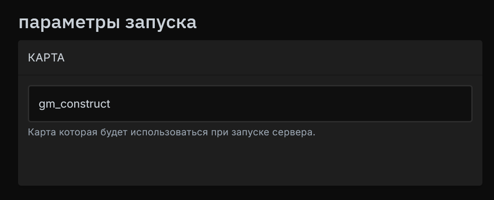

# <GmodLogo>Изменение карты при запуске</GmodLogo>

Краткое руководство по изменению карты по умолчанию на игровом сервере Garry's Mod.

## Установка переменной в параметрах запуска

Перейдите в управление нужным сервером.

Перейдите в параметры запуска сервера и найдите параметр "Карта".

Введите полное название карты, например `gm_construct`.

{data-zoomable}

Готово! Теперь сервер будет загружаться с этой картой при каждом запуске сервера.

## Просмотр установленных карт на сервере

Если вы не уверены, какие карты установлены на вашем сервере, вы можете легко узнать полный список (включая карты из Workshop), воспользовавшись командой `maps *` в консоли.

{data-zoomable}

## Установка карты из Steam Workshop

Добавьте карту в [Workshop-коллекцию сервера](/ru/games/gmod/workshop). Запустите сервер на встроенной карте, например `gm_construct`, дождитесь загрузки коллекции и проверьте консоль на наличие ошибок. Командой `maps *` узнайте имя установленной карты, укажите его без `.bsp` в параметрах запуска и перезапустите сервер.

Если карта всё ещё не загружается при запуске, проверьте необходимые зависимости на её странице Workshop. Если автор предоставляет прямую загрузку `.bsp`, поместите файл в `/garrysmod/maps/` и укажите его имя без расширения.
