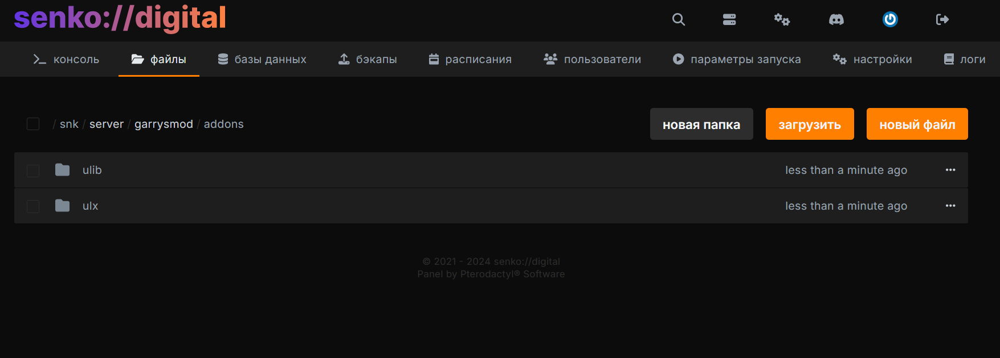
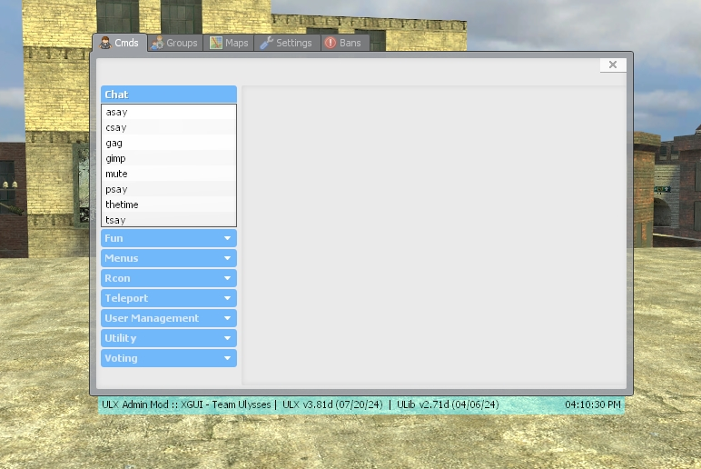

# <GmodLogo>Установка и настройка ULX</GmodLogo>

Краткое руководство по установке и настройке админ-системы **ULX** на вашем Garry's Mod сервере.

## Вступление

**ULX** - это мощная административная система для серверов Garry's Mod, которая предоставляет широкий спектр возможностей для управления сервером.

В этом руководстве мы рассмотрим процесс скачивания и установки **ULX** и **ULib**, выдачи прав суперадминистратора, а так же использования интерфейса ULX.

## Скачивание аддонов

Для начала, вам необходимо скачать **ULX** и **ULib** к себе на ПК.

[**[Скачать ULib](https://github.com/TeamUlysses/ulib/archive/refs/heads/master.zip)**]

[**[Скачать ULX](https://github.com/TeamUlysses/ulx/archive/refs/heads/master.zip)**]

## Установка на сервер

1. Загрузите оба архива по пути `/garrysmod/addons/` с помощью файлового менеджера в панели управления.
2. Нажмите ПКМ по архиву **ULib**, выберите опцию "распаковать". Удалите архив после окончания распаковки. Для удобства вы можете переименовать новую папку под `ulib`, убрав оттуда `-master`
3. Распакуйте архив **ULX**, удалите архив после распаковки, и так же переименуйте папку под `ulx`, убрав оттуда `-master`

{data-zoomable}

После этого **ULX** и **ULib** будут установлены на ваш сервер.

::: tip
Ссылки безопасны, и ссылаются на официальный GitHub репозиторий от оригинального разработчика аддона - **Team Ulysses**.
:::

Перезапустите сервер после установки обоих аддонов.

## Первичная настройка ULX

После установки **ULX** и **ULib**, вам необходимо провести начальную настройку администраторских привилегий.

### Выдача прав суперадмина

По умолчанию список суперадминов и админов пуст. Давайте же исправим это!

#### Выдача прав через никнейм

Перейдите в консоль своего игрового сервера и выдайте себе права суперадмина с помощью команды:

```
ulx adduser "nickname" superadmin
```

Для того, чтобы команда с никнеймом сработала, вы должны быть подключены к игровому серверу. Выполняйте её в консоли панели хостинга - кавычки нужны для ников с пробелами.

где `nickname` - ваш никнейм в Steam.

#### Выдача прав через SteamID

Если вам никнейм сложен в написании, или вы не хотите заходить на сервер для выдачи прав, вы так же можете выдать себе права суперадмина с помощью своего SteamID.

Его можно получить с помощью сайта [steamid.xyz](https://steamid.xyz/)

Пример выполнения команды:

```lua
ulx adduserid STEAM_0:1:7099 superadmin
```

### Открытие меню

В самой игре вы можете пользоваться меню управления ULX - именно там и производится настройка прав администраторов и обычных пользователей, а так же выполняются различные команды.

Открыть меню можно с помощью консольной команды (в самой игре):

```lua
ulx menu
```

#### Назначение клавиши для открытия меню

Для более удобного открытия меню, вы так же можете назначить его открытие на любую удобную вам кнопку.

Делается это с помощью следующей команды:

```lua
bind [кнопка] "ulx menu"
```

Например:

```lua
bind m "ulx menu"
```

Готово! Теперь меню будет открываться без использования лишних консольных команд.

{data-zoomable}

Теперь вы можете перейти к дальнейшей настройке ULX без лишних заморочек.

## Консольные команды ULX

Посмотреть доступные вам команды на сервере можно через `ulx help`.

`<Аргумент>` нужно указать, а `[аргумент]` можно пропустить. Скобки вводить не нужно. Вместо `Sen`, `Katie` и SteamID из примеров подставьте данные своих игроков. Никнеймы с пробелами пишите в кавычках.

Команды выполняются в консоли панели хостинга или в игровой консоли при наличии прав. Команды меню, наблюдения, `bring`, `goto`, `teleport`, `jailtp` и `ent` выполняйте из игровой консоли. Если не указать необязательный аргумент `[игрок]`, команда применяется к вам.

В командах с несколькими целями можно использовать `*` для всех игроков, `^` для себя или перечислить никнеймы через запятую.

### Команды для забавы

| Команда | Пример | Описание |
| --- | --- | --- |
| `ulx armor <игрок> <броня>` | `ulx armor Sen 100` | Устанавливает броню от 0 до 255. |
| `ulx blind <игрок> [значение]` | `ulx blind Sen 255` | Затемняет экран игрока. Значение от 0 до 255, по умолчанию - 255, полностью чёрный экран. |
| `ulx unblind <игрок>` | `ulx unblind Sen` | Убирает затемнение экрана. |
| `ulx cloak [игрок] [значение]` | `ulx cloak Sen 255` | Делает игрока невидимым. Степень невидимости - от 0 до 255, по умолчанию 255 - полная невидимость. |
| `ulx uncloak [игрок]` | `ulx uncloak Sen` | Снова делает игрока видимым. |
| `ulx freeze <игрок>` | `ulx freeze Sen` | Замораживает игрока на месте. |
| `ulx unfreeze <игрок>` | `ulx unfreeze Sen` | Снимает заморозку. |
| `ulx god [игрок]` | `ulx god Sen` | Включает бессмертие. |
| `ulx ungod [игрок]` | `ulx ungod Sen` | Отключает бессмертие. |
| `ulx hp <игрок> <здоровье>` | `ulx hp Sen 100` | Устанавливает здоровье, не меньше 1. |
| `ulx ignite <игрок> [секунды]` | `ulx ignite Sen 10` | Поджигает игрока на 1–300 секунд. По умолчанию 300 секунд. |
| `ulx unignite <игрок>` | `ulx unignite Sen` | Тушит выбранного игрока. |
| `ulx unigniteall` | `ulx unigniteall` | Тушит всех игроков и горящие объекты на сервере. |
| `ulx jail <игрок> [секунды]` | `ulx jail Sen 60` | Сажает игрока в клетку на указанное число секунд. Без времени или при 0 - до команды `ulx unjail`. |
| `ulx unjail <игрок>` | `ulx unjail Sen` | Выпускает игрока из клетки. |
| `ulx jailtp <игрок> [секунды]` | `ulx jailtp Sen 60` | Телепортирует игрока туда, куда вы смотрите, и сажает в клетку. Время задаётся в секундах, как у `ulx jail`. |
| `ulx maul <игрок>` | `ulx maul Sen` | Натравливает на игрока быстрых зомби. |
| `ulx playsound <звук>` | `ulx playsound buttons/button14.wav` | Проигрывает звук всем игрокам. Путь - относительно папки `sound/`. |
| `ulx ragdoll <игрок>` | `ulx ragdoll Sen` | Превращает игрока в ragdoll. |
| `ulx unragdoll <игрок>` | `ulx unragdoll Sen` | Возвращает игрока в обычное состояние. |
| `ulx slap <игрок> [урон]` | `ulx slap Sen 5` | Подбрасывает игрока и наносит указанный урон. По умолчанию урон равен 0. |
| `ulx whip <игрок> [количество] [урон]` | `ulx whip Sen 5 2` | Повторяет `slap` от 2 до 100 раз. По умолчанию - 10 раз без урона. |
| `ulx slay <игрок>` | `ulx slay Sen` | Убивает выбранного игрока. |
| `ulx sslay <игрок>` | `ulx sslay Sen` | Убивает игрока без обычных эффектов смерти. |
| `ulx strip <игрок>` | `ulx strip Sen` | Удаляет оружие игрока. |

### Выполнение команд и Lua

| Команда | Пример | Описание |
| --- | --- | --- |
| `ulx cexec <игрок> <команда>` | `ulx cexec Sen "say Привет"` | Выполняет команду в консоли игрока, если игра разрешает её удалённый запуск. |
| `ulx luarun <код>` | `ulx luarun =game.GetMap()` | Выполняет Lua-код на сервере. `=` перед выражением выводит результат. |
| `ulx rcon <команда>` | `ulx rcon status` | Выполняет команду в консоли сервера. |
| `ulx exec <файл>` | `ulx exec server.cfg` | Выполняет конфигурационный файл из папки `garrysmod/cfg/`. |
| `ulx ent <класс> [параметры]` | `ulx ent prop_physics model:models/props_c17/oildrum001.mdl` | Создаёт объект там, куда вы смотрите. Параметры: `ключ:значение`, разделитель - `\|`. |

### Группы и права доступа

Название команды указывайте целиком и в кавычках: `"ulx kick"`. Метка доступа позволяет ограничить аргументы, например максимальный урон. Подробнее - в `ulx usermanagementhelp`.

| Команда | Пример | Описание |
| --- | --- | --- |
| `ulx addgroup <группа> [родительская_группа]` | `ulx addgroup moderator user` | Создаёт группу с наследованием прав. По умолчанию наследует `user`. |
| `ulx adduser <игрок> <группа>` | `ulx adduser Sen moderator` | Добавляет подключённого игрока в существующую группу. |
| `ulx adduserid <ID> <группа>` | `ulx adduserid STEAM_0:1:123456 moderator` | Назначает группу по SteamID, IP или UniqueID. Игроку не обязательно находиться на сервере. |
| `ulx groupallow <группа> <команда> [метка_доступа]` | `ulx groupallow moderator "ulx kick"` | Даёт группе доступ к команде. |
| `ulx groupdeny <группа> <команда>` | `ulx groupdeny moderator "ulx kick"` | Убирает выданное группе разрешение. Унаследованные права сохраняются. |
| `ulx removegroup <группа>` | `ulx removegroup moderator` | Удаляет группу. |
| `ulx removeuser <игрок>` | `ulx removeuser Sen` | Удаляет запись игрока, включая его группу и личные права. |
| `ulx removeuserid <ID>` | `ulx removeuserid STEAM_0:1:123456` | Удаляет запись игрока по SteamID, IP или UniqueID. |
| `ulx renamegroup <группа> <новое_название>` | `ulx renamegroup moderator helper` | Меняет название существующей группы. |
| `ulx setgroupcantarget <группа> [цели]` | `ulx setgroupcantarget moderator "!%admin"` | Ограничивает, на кого группа может применять команды. В примере - на всех, кроме администраторов и выше. Без второго аргумента снимает ограничение. |
| `ulx userallow <игрок> <команда> [метка_доступа]` | `ulx userallow Sen "ulx slap" "* 0:10"` | Даёт игроку доступ к команде. В примере - к `slap` с уроном от 0 до 10. |
| `ulx userallowid <ID> <команда> [метка_доступа]` | `ulx userallowid STEAM_0:1:123456 "ulx kick"` | Даёт доступ к команде по SteamID, IP или UniqueID. |
| `ulx userdeny <игрок> <команда> [снять_правило]` | `ulx userdeny Sen "ulx kick"` | Запрещает команду, даже если она разрешена группе. Аргумент `1` убирает личное правило и оставляет доступ по группе. |
| `ulx userdenyid <ID> <команда> [снять_правило]` | `ulx userdenyid STEAM_0:1:123456 "ulx kick"` | Работает как `ulx userdeny`, но принимает SteamID, IP или UniqueID. |
| `ulx usermanagementhelp` | `ulx usermanagementhelp` | Показывает справку по группам и правам доступа. |

### Управление игроками и картой

| Команда | Пример | Описание |
| --- | --- | --- |
| `ulx ban <игрок> [минуты] [причина]` | `ulx ban Sen 60 "Повторный спам"` | Банит игрока на указанное число минут. Без времени или при 0 - навсегда. |
| `ulx banid <SteamID> [минуты] [причина]` | `ulx banid STEAM_0:1:123456 60 "Повторный спам"` | Банит по SteamID, даже если игрок не на сервере. Время - в минутах, как у `ulx ban`. |
| `ulx unban <SteamID>` | `ulx unban STEAM_0:1:123456` | Снимает бан по SteamID. |
| `ulx kick <игрок> [причина]` | `ulx kick Sen "Смените никнейм"` | Кикает игрока с указанной причиной. |
| `ulx map <карта> [режим]` | `ulx map gm_construct sandbox` | Меняет карту. Вторым аргументом можно указать игровой режим. |
| `ulx noclip [игрок]` | `ulx noclip Sen` | Включает или отключает свободный полёт сквозь объекты. |
| `ulx spectate <игрок>` | `ulx spectate Sen` | Включает наблюдение за игроком. |
| `ulx who [SteamID]` | `ulx who` | Показывает игроков онлайн и их группы. Со SteamID - данные конкретного игрока. |

### Вспомогательные команды

| Команда | Пример | Описание |
| --- | --- | --- |
| `ulx help` | `ulx help` | Показывает доступные вам команды и их аргументы. |
| `ulx version` | `ulx version` | Выводит установленные версии ULX и ULib. |
| `ulx debuginfo` | `ulx debuginfo` | Выводит данные о сервере, игроках и настройках для поиска проблем. |
| `ulx resettodefaults [FORCE]` | `ulx resettodefaults` | Сбрасывает настройки ULX и ULib, включая группы, права и баны. Для подтверждения нужно добавить `FORCE`, после сброса - сменить карту. |

### Управление чатом

| Команда | Пример | Описание |
| --- | --- | --- |
| `ulx asay <сообщение>` | `ulx asay "Проверьте зону появления игроков"` | Отправляет сообщение подключённым администраторам. |
| `ulx csay <сообщение>` | `ulx csay "Перезапуск через 5 минут"` | Показывает сообщение в центре экрана у всех игроков. |
| `ulx tsay <сообщение>` | `ulx tsay "Ознакомьтесь с правилами сервера"` | Отправляет сообщение всем игрокам в текстовый чат. |
| `ulx psay <игрок> <сообщение>` | `ulx psay Sen "Свяжитесь с администратором"` | Отправляет игроку личное сообщение. |
| `ulx gag <игрок>` | `ulx gag Sen` | Отключает игроку голосовой чат. |
| `ulx ungag <игрок>` | `ulx ungag Sen` | Включает голосовой чат обратно. |
| `ulx mute <игрок>` | `ulx mute Sen` | Отключает игроку текстовый чат. |
| `ulx unmute <игрок>` | `ulx unmute Sen` | Включает текстовый чат обратно. |
| `ulx gimp <игрок>` | `ulx gimp Sen` | Заменяет сообщения игрока фразами из списка ULX. |
| `ulx ungimp <игрок>` | `ulx ungimp Sen` | Отключает замену сообщений. |
| `ulx thetime` | `ulx thetime` | Показывает текущее время сервера. |

### Голосования

| Команда | Пример | Описание |
| --- | --- | --- |
| `ulx vote <вопрос> <вариант1> <вариант2> [другие_варианты]` | `ulx vote "Сменить карту?" "Да" "Нет"` | Запускает голосование с 2–10 вариантами ответа. |
| `ulx stopvote` | `ulx stopvote` | Останавливает голосование. |
| `ulx voteban <игрок> [минуты] [причина]` | `ulx voteban Sen 60 "Повторный спам"` | Запускает голосование за бан. Время - в минутах, по умолчанию 1440 (сутки). При 0 - навсегда. |
| `ulx votekick <игрок> [причина]` | `ulx votekick Sen "Повторный спам"` | Запускает голосование за кик игрока. |
| `ulx votemap [карта]` | `ulx votemap gm_construct` | Отдаёт голос за карту. Без аргумента выводит список карт. Карта сменится, когда наберётся нужное число голосов. |
| `ulx votemap2 <карта> [другие_карты]` | `ulx votemap2 gm_construct gm_flatgrass` | Запускает голосование за смену карты. Принимает от 1 до 10 карт. |
| `ulx veto` | `ulx veto` | Отменяет смену карты после успешного `ulx votemap`. |

### Телепортация

| Команда | Пример | Описание |
| --- | --- | --- |
| `ulx bring <игрок>` | `ulx bring Sen` | Телепортирует игрока к вам. |
| `ulx goto <игрок>` | `ulx goto Sen` | Телепортирует вас к игроку. |
| `ulx return [игрок]` | `ulx return Sen` | Возвращает игрока на место до телепортации. |
| `ulx send <игрок> <второй_игрок>` | `ulx send Sen Katie` | Телепортирует первого игрока ко второму. |
| `ulx teleport [игрок]` | `ulx teleport Sen` | Телепортирует игрока туда, куда вы смотрите. |

### Меню

Эти команды выполняются в игровой консоли.

| Команда | Пример | Описание |
| --- | --- | --- |
| `ulx motd` | `ulx motd` | Открывает приветственное окно MOTD. |
| `ulx menu` | `ulx menu` | Открывает или закрывает меню XGUI. |
| `xgui [действие]` | `xgui show` | Управляет меню XGUI: `show` - открыть, `hide` - закрыть, `toggle` - переключить состояние. |
| `xgui fban <игрок>` | `xgui fban Sen` | Замораживает игрока и открывает окно бана с его данными. |
| `xgui xban [игрок]` | `xgui xban Sen` | Открывает окно бана. Если указан игрок, заполняет его данные. |
