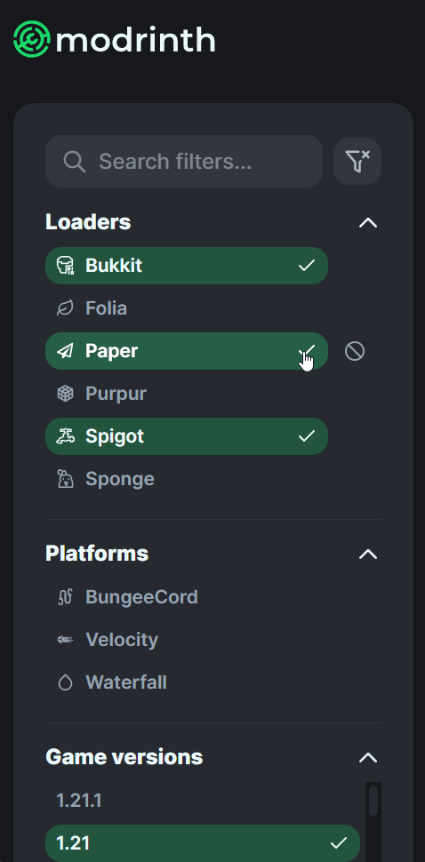
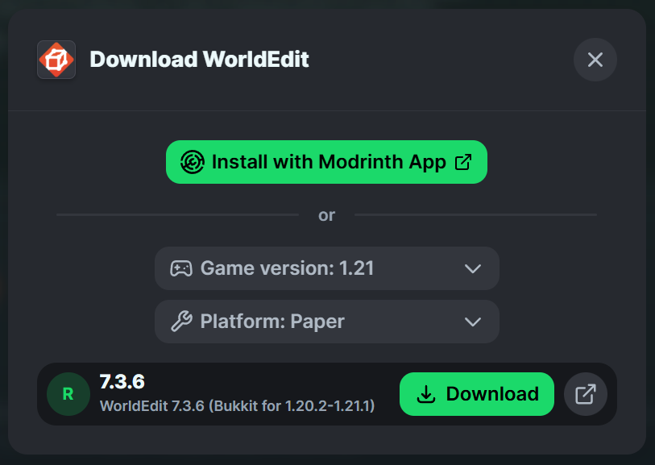
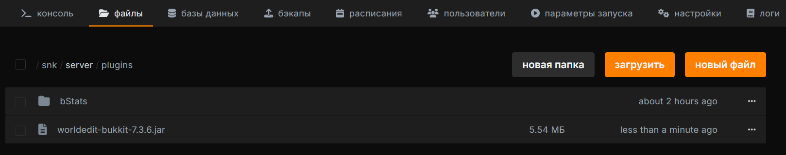
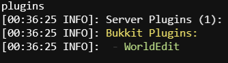

# <MinecraftLogo>Установка плагинов</MinecraftLogo>

Краткое руководство по установке плагинов на сервер Minecraft.

***

::: tip
Эта инструкция подходит для плагинов Bukkit/Spigot на совместимых серверах, например [Paper](https://papermc.io/). Fabric и Forge используют моды, которые обычно устанавливаются в папку `mods`. Перед скачиванием ознакомьтесь с [руководством по выбору ядра](/ru/games/minecraft/software).
:::

Paper поддерживает плагины Bukkit и Spigot. Плагины, использующие возможности только Paper, не будут работать на CraftBukkit или Spigot. На странице плагина проверьте поддерживаемое ядро, версию Minecraft, Java и необходимые зависимости. Подробнее — в [документации Paper](https://docs.papermc.io/paper/adding-plugins/).

Скачивайте плагины у разработчиков или с проверенных площадок: [Hangar](https://hangar.papermc.io/), [Bukkit](https://dev.bukkit.org/bukkit-plugins), [Spigot Resources](https://www.spigotmc.org/resources/) и [Modrinth](https://modrinth.com/plugins).

### Скачивание плагинов

В этом руководстве мы возьмём за пример сайт [Modrinth](https://modrinth.com/plugins), так как по нашему мнению он является наиболее удобным.
Начнём с фильтров.

Основными фильтрами являются ядро (платформа) и версия сервера.

{data-zoomable}

После того как Вы выбрали плагин и зашли на его страницу, нажмите на кнопку "Download".

{data-zoomable}

Дальше появится окно, где нужно будет выбрать версию и ядро (платформу).

{data-zoomable}

### Установка плагина на сервер

Остановите сервер перед установкой или заменой плагина. После скачивания плагина перейдите в управление файлами сервера, после - в папку `plugins`, и загрузите туда файл(-ы) самого плагина. В нашем случае это `worldedit-bukkit-7.3.6.jar`.

{data-zoomable}

### Проверка работоспособности плагина

Запустите сервер и выполните команду `plugins` в консоли. Убедитесь, что плагин включён, а не просто присутствует в списке. Если он выделен красным или не загрузился, проверьте консоль на ошибки совместимости и недостающие зависимости.

{data-zoomable}
