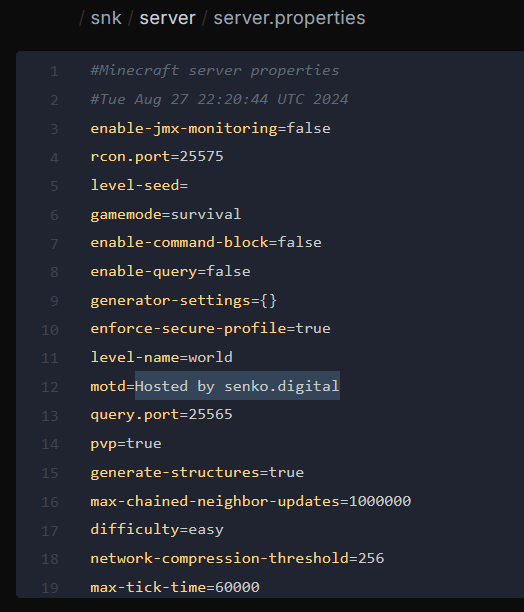
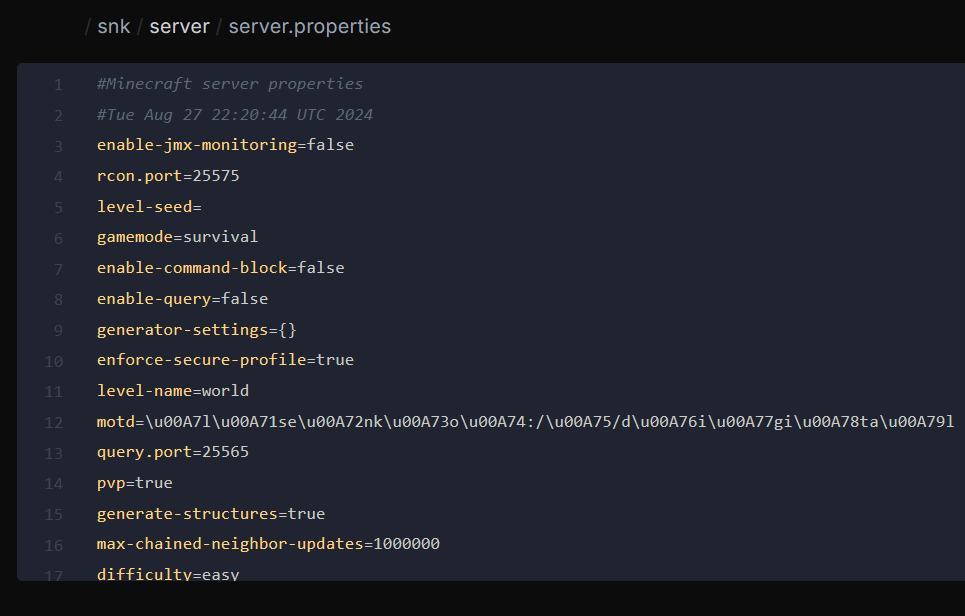
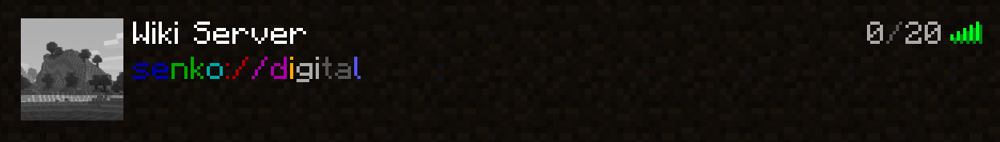

# <MinecraftLogo>Изменение MOTD сервера</MinecraftLogo>

Краткое руководство по изменению MOTD Minecraft сервера в игровой панели управления.

***

::: tip
Для генерации красивого MOTD рекомендуем воспользоваться **[MCTools](https://mctools.org/motd-creator)**
:::

Перейдите в управление нужным сервером.

Войдите в файловый менеджер, и откройте файл `server.properties`.

{data-zoomable}

Остановите сервер и замените значение после `motd=` на свой текст. Оформление можно сгенерировать с помощью сервиса выше. Это изменяет описание в списке серверов, а не название, которое игрок сохраняет у себя.

{data-zoomable}

Сохраните файл, запустите сервер и обновите список в игре. Теперь название вашего сервера будет сверкать по настоящему :sparkles:

{data-zoomable}
