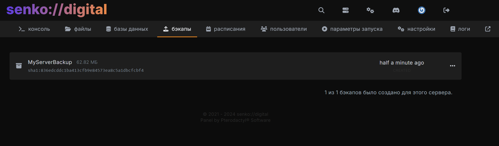

# Бэкапы

Краткое руководство по созданию и использованию бэкапов в игровой панели управления.

## Описание страницы

С помощью данной вкладки можно создавать новые и восстанавливать старые бэкапы файлов вашего игрового сервера.

Эта функция очень полезна, если вам нужны регулярные резервные копии данных вашего сервера, или нужно выгрузить сборку самых важных файлов на вашем сервере.

По умолчанию для каждой услуги доступно одно место для резервной копии размером до 50 GB. Для запроса дополнительного места обратитесь в поддержку.

{data-zoomable}

Наличие места для бэкапа не означает, что он создаётся автоматически. Создайте его вручную или настройте [расписание](./schedules). В бэкап входят файлы сервера; базы данных из [вкладки «Базы данных»](./databases) нужно экспортировать отдельно.

## Создание нового бэкапа

Для создания нового бэкапа нажмите на кнопку **«Создать бэкап»**.

В открывшемся окне введите желаемое название бэкапа латиницей, остальные поля рекомендуется оставить пустыми.

<video width="1440" autoplay loop muted controls>
  <source src="/videos/panel/backups/create-backup.mp4" type="video/mp4" />
</video>

## Скачивание бэкапа

Напротив названия бэкапа нажмите на выпадающее меню, и выберите опцию **«скачать»**.

<video width="1440" autoplay loop muted controls>
  <source src="/videos/panel/backups/download-backup.mp4" type="video/mp4" />
</video>

## Удаление бэкапа

Напротив названия бэкапа нажмите на выпадающее меню, и выберите опцию **«удалить»**.

::: danger
**Внимание**: при удалении бэкапа потеряются все данные из него, настоятельно рекомендуем загрузить его перед совершением данной операции.
:::

<video width="1440" autoplay loop muted controls>
  <source src="/videos/panel/backups/delete-backup.mp4" type="video/mp4" />
</video>

## Восстановление из бэкапа

Напротив названия бэкапа нажмите на выпадающее меню, и выберите опцию **«восстановить»**.

<video width="1440" autoplay loop muted controls>
  <source src="/videos/panel/backups/restore-backup.mp4" type="video/mp4" />
</video>

::: warning
Перед восстановлением остановите сервер и сохраните текущие файлы, которые могут понадобиться. Если выбрать удаление существующих файлов, они будут удалены перед восстановлением. Если оставить их, файлы, которых нет в бэкапе, сохранятся — в том числе ненужные или повреждённые.
:::

Дождитесь завершения восстановления, прежде чем запускать сервер. Время зависит от размера бэкапа.

## Запрет удаления бэкапа

Напротив названия бэкапа нажмите на выпадающее меню, и выберите опцию **«запретить удаление»**.

<video width="1440" autoplay loop muted controls>
  <source src="/videos/panel/backups/lock-backup.mp4" type="video/mp4" />
</video>

::: tip
Теперь вы и другие пользователи не смогут случайно удалить бэкап.
:::

## Разрешение удаления бэкапа

Напротив названия бэкапа нажмите на выпадающее меню, и выберите опцию **«разрешить удаление»**.

<video width="1440" autoplay loop muted controls>
  <source src="/videos/panel/backups/unlock-backup.mp4" type="video/mp4" />
</video>

::: tip
Теперь вы и другие пользователи смогут удалить бэкап в любое время.
:::
