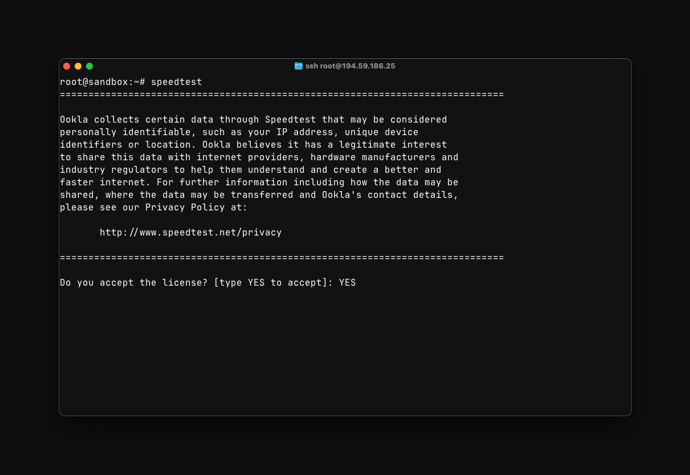
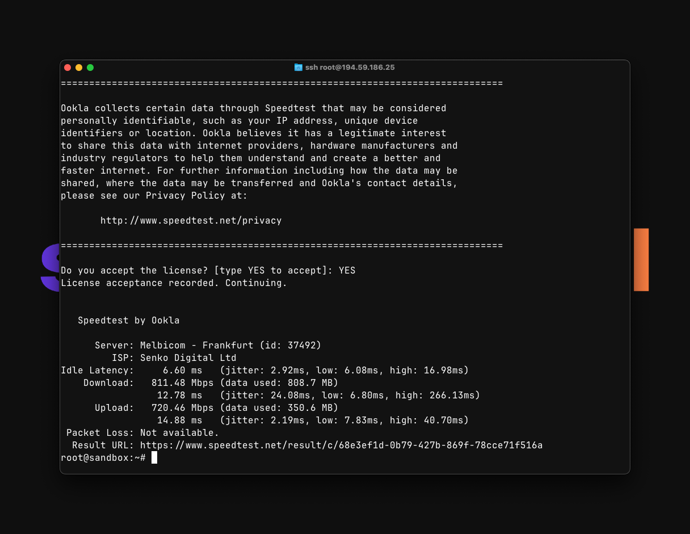

# Тестирование скорости сервера

Speedtest CLI - это официальная утилита от Ookla для тестирования скорости соединения через командную строку вашего сервера.

Данная инструкция поможет установить и использовать Speedtest CLI на различных операционных системах.

## Установка

Проверьте поддержку вашей версии ОС на [официальной странице Speedtest CLI](https://www.speedtest.net/apps/cli). На FreeBSD устанавливайте только пакет для вашей версии системы.

::: tip Ubuntu 24.04, Ubuntu 26.04 и Debian 13
Для Debian 13 (Trixie) в репозитории Ookla пакеты уже есть, поэтому подменять версию не нужно.

Для Ubuntu 24.04 (Noble) и Ubuntu 26.04 (Resolute) пакетов в репозитории пока нет. На этих версиях замените команду установки репозитория ниже на следующую, чтобы использовать репозиторий Ookla для Ubuntu 22.04 (Jammy):

```bash
curl -fsSL https://packagecloud.io/install/repositories/ookla/speedtest-cli/script.deb.sh | sudo env os=ubuntu dist=jammy bash
```

Это изменит только репозиторий Ookla, а не системные репозитории Ubuntu. Затем продолжите установку командами `sudo apt-get update` и `sudo apt-get install speedtest`.
:::

::: code-group

```bash [Ubuntu/Debian]
# Установите sudo, если он ещё не установлен
apt install sudo -y

# Удаление неофициальных версий Speedtest CLI
sudo apt-get remove speedtest
sudo apt-get remove speedtest-cli

# Установка репозитория Speedtest CLI
sudo apt-get install curl
curl -fsSL https://packagecloud.io/install/repositories/ookla/speedtest-cli/script.deb.sh | sudo bash


# Установка программы Speedtest CLI
sudo apt-get update
sudo apt-get install speedtest
```

```bash [Fedora/CentOS/RedHat]
# Удаление неофициальных версий Speedtest CLI
sudo yum remove speedtest

# Установка Speedtest CLI
curl -s https://packagecloud.io/install/repositories/ookla/speedtest-cli/script.rpm.sh | sudo bash
sudo yum install speedtest
```


:::

## Использование

Для запуска теста скорости выполните команду:

```bash
speedtest
```

При первом запуске утилиты требуется принять лицензионное соглашение и [политику конфиденциальности](https://www.speedtest.net/privacy):

{data-zoomable}

Для принятия условий введите `YES` и нажмите `[Enter]`

После принятия условий утилита автоматически начнёт тестирование скорости сети:

{data-zoomable}

По завершению тестирования утилита сгенерирует ссылку на результаты теста, которую можно использовать для отправки в службу поддержки или обмена результатов с друзьями.

---

Для выбора конкретного сервера используйте:

```bash
speedtest --server-id=1234
```

где `1234` - ID сервера Speedtest

---

Для просмотра списка доступных серверов используйте команду:

```bash
speedtest --servers
```

## Дополнительные параметры

### Основные параметры

- `-h, --help` - вывод справки
- `-v` - уровень подробности логов (можно указать несколько раз, например `-vvv`)
- `-V, --version` - вывод версии утилиты
- `-L, --servers` - вывод списка ближайших серверов
- `--selection-details` - вывод деталей выбора сервера
- `-s id, --server-id=id` - указание конкретного сервера по ID
- `-o hostname, --host=hostname` - указание сервера по имени хоста
- `-f format_type, --format=format_type` - формат вывода (по умолчанию `human-readable`)
- `--progress=yes|no` - включение/отключение индикатора прогресса
- `-I interface, --interface=interface` - привязка к определённому сетевому интерфейсу
- `-i ip_address, --ip=ip_address` - привязка к определённому IP-адресу
- `--ca-certificate=path` - путь к сертификату CA

### Форматы вывода

- `human-readable` - человекочитаемый формат (установлен по умолчанию)
- `csv` - значения, разделенные запятыми
- `tsv` - значения, разделенные табуляцией
- `json` - JavaScript Object Notation (компактный)
- `jsonl` - JavaScript Object Notation (построчный)
- `json-pretty` - JavaScript Object Notation (форматированный)

### Единицы измерения скорости

#### Десятичные единицы
- `bps` - бит в секунду
- `kbps` - килобит в секунду
- `Mbps` - мегабит в секунду
- `Gbps` - гигабит в секунду
- `B/s` - байт в секунду
- `kB/s` - килобайт в секунду
- `MB/s` - мегабайт в секунду
- `GB/s` - гигабайт в секунду

#### Двоичные единицы
- `kibps` - кибибит в секунду
- `Mibps` - мебибит в секунду
- `Gibps` - гибибит в секунду
- `kiB/s` - кибибайт в секунду
- `MiB/s` - мебибайт в секунду
- `GiB/s` - гибибайт в секунду

### Сокращения для единиц измерения

- `-a` - сокращение для `-u auto-decimal-bits`
- `-A` - сокращение для `-u auto-decimal-bytes`
- `-b` - сокращение для `-u auto-binary-bits`
- `-B` - сокращение для `-u auto-binary-bytes`

## Пример использования

```bash
# Базовый тест скорости к ближайшему серверу, авто-подбор
speedtest
```

```bash
# Тест скорости с выбором сервера и выводом в JSON
speedtest --server-id=1234 --format=json
```

```bash
# Тест скорости с отключенным индикатором прогресса
speedtest --progress=no
```

```bash
# Тест скорости с выводом в мегабайтах в секунду
speedtest --unit=MB/s
```

```bash
# Тест скорости с привязкой к конкретному сетевому интерфейсу
speedtest --interface=eth0
```
