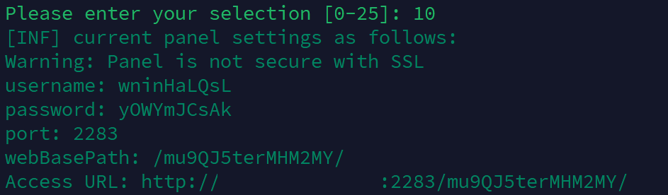
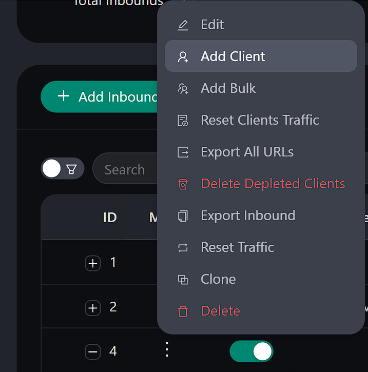
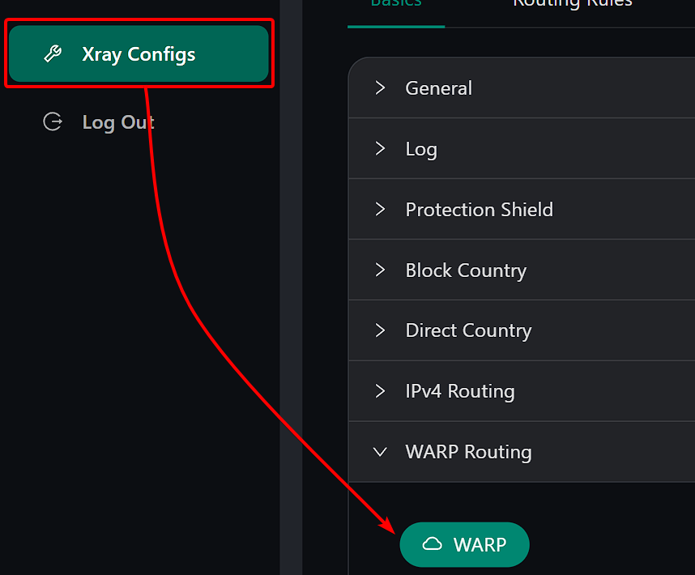

# Руководство по установке и использованию панели 3X-UI

<p align="center">
  <picture>
    <source media="(prefers-color-scheme: dark)" srcset="/images/vpn/3x-ui/x-ui.png">
    
  </picture>
</p>

3X-UI - веб-панель для настройки VPN на сервере. Она поддерживает протоколы VMess, VLESS, Trojan, ShadowSocks и WireGuard.

В панели можно создавать подключения, добавлять пользователей, ограничивать трафик и количество IP-адресов, а также задавать срок доступа.
<!-- 
::: tip Подсказка 
Клиентам нашего хостинга доступна полностью автоматическая установка панели 3X-UI при первоначальном заказе услуги или с помощью скриптов в панели управления ВМ. Останется только лишь создать пользователей и настроить конфигурации для устройств.
::: -->

#### Особенности 3X-UI

- Многоязычный интерфейс (английский, фарси, китайский, русский, вьетнамский, испанский)
- Поддержка множества протоколов (VMess, VLESS, Trojan, ShadowSocks, WireGuard)
- Управление несколькими пользователями
- Установка лимитов трафика, срока действия и IP-адресов
- Автоматическое управление SSL-сертификатами
- Интуитивно понятный веб-интерфейс
- Статистика использования трафика
- Возможность блокировки рекламы и маршрутизации трафика
- Поддержка технологии Reality для обхода блокировок

## Процесс установки

<!-- ### Автоматическая установка для клиентов хостинга

#### При заказе услуги

В меню заказа через выпадающее меню выберите опцию "3X-UI", завершите заказ и дождитесь окончания обработки услуги. 

Сразу после активации сервера вы получите данные для входа в ОС сервера, а также данные для входа в 3X-UI, после чего вы можете [совершить вход](/ru/vpn/3x-ui#вход-в-веб-панель) и начать [настройку подключений](/ru/vpn/3x-ui#настроика-подключении-inbounds).

#### Через панель управления ВМ

Перейдите в [панель управления ВМ](https://vm.senko.digital), перейдите в управление нужным сервером, в правом верхнем углу раскройте "Меню" и выберите опцию "Запустить скрипт". 

В диалоге выберите опцию "3X-UI" и активируйте опцию "Отправить письмо, которое привязано к скрипту".

По окончанию установки вы получите письмо с данными для входа в панель управления, после чего вы можете [совершить вход](/ru/vpn/3x-ui#вход-в-веб-панель) и начать [настройку подключений](/ru/vpn/3x-ui#настроика-подключении-inbounds). -->

### Стандартная установка

Подключитесь к VPS по SSH под root или сначала выполните `sudo -i`. На Ubuntu или Debian установите `curl` перед запуском установщика:

```bash
apt update
apt install -y curl
```

Затем установите 3X-UI:

```bash
bash <(curl -Ls https://raw.githubusercontent.com/mhsanaei/3x-ui/master/install.sh)
```

Во время установки вам будет предложено:

1. Выбрать тип базы данных (для личного использования рекомендуется SQLite, пункт 1).

2. Изменить настройки панели (для повышения безопасности рекомендуется ответить `y`).

3. Указать порт панели (рекомендуется использовать нестандартный порт).

4. Создать SSL-сертификат для домена или IP-адреса (рекомендуется создать как минимум для IP-адреса, пункт 2).


### Установка определённой версии

Чтобы установить определённую версию панели, укажите её номер в переменной `VERSION`. Например, для версии v1.7.9:

```bash
VERSION=v1.7.9 && bash <(curl -Ls "https://raw.githubusercontent.com/mhsanaei/3x-ui/$VERSION/install.sh") $VERSION
```

Это только пример указания версии. Версия `v1.7.9` устарела; для настройки REALITY и XHTTP по инструкции ниже используйте актуальный выпуск.

### Установка через Docker

1. Установите Docker:

```bash
bash <(curl -sSL https://get.docker.com)
```

2. Создайте папку для панели и её данных:

```bash
mkdir -p 3x-ui
cd 3x-ui
```

3. Создайте в этой папке файл `compose.yaml` со следующим содержимым. Здесь используются готовый образ панели и сеть сервера, чтобы Xray мог обращаться к Nginx на VPS по адресу `127.0.0.1:8443`:

```yaml
services:
  3x-ui:
    image: ghcr.io/mhsanaei/3x-ui:latest
    container_name: 3x-ui
    network_mode: host
    restart: unless-stopped
    cap_add:
      - NET_ADMIN
      - NET_RAW
    volumes:
      - ./db:/etc/x-ui
      - ./cert:/root/cert
      - ./acme:/root/.acme.sh
```

4. Запустите панель:

```bash
docker compose up -d
```

Или альтернативный вариант:

```bash
docker run -itd \
   -e XRAY_VMESS_AEAD_FORCED=false \
   -v $PWD/db/:/etc/x-ui/ \
   -v $PWD/cert/:/root/cert/ \
   -v $PWD/acme/:/root/.acme.sh/ \
   --cap-add=NET_ADMIN --cap-add=NET_RAW \
   --network=host \
   --restart=unless-stopped \
   --name 3x-ui \
   ghcr.io/mhsanaei/3x-ui:latest
```

Используйте только один из этих способов. При обновлении или пересоздании контейнера сохраняйте папки `db`, `cert` и `acme`.

При первом запуске контейнер создаёт имя пользователя и пароль и выводит их в журнал. Посмотрите и сохраните их:

```bash
docker logs 3x-ui
docker exec 3x-ui /app/x-ui setting -show
```

Вторая команда показывает порт панели и путь в её адресе. Новый контейнер сначала использует HTTP. Чтобы войти в панель через защищённое SSH-соединение, пока HTTPS ещё не настроен, выполните на своём компьютере `ssh -L 18053:127.0.0.1:2053 root@YOUR_SERVER_IP`, подставив IP-адрес VPS. Оставьте это SSH-соединение открытым и перейдите в браузере на `http://127.0.0.1:18053/`. Если в настройках указан другой порт или путь панели, замените `2053` и добавьте этот путь к адресу. После настройки сертификата домена ниже используйте HTTPS-адрес панели.

## Настройка SSL-сертификата

Настроить SSL-сертификат в 3X-UI можно несколькими способами.

### ACME

**Для управления SSL-сертификатами с помощью ACME:**

1. Убедитесь, что ваш домен корректно указывает на этот сервер (т.е. А-запись в DNS настроена правильно).
2. Запустите команду `x-ui` в терминале, затем выберите пункт `Управление SSL-сертификатами` (пункт 19).
3. Вам будут предложены следующие варианты:
    - **Получить SSL (Домен):** Получить SSL-сертификат для домена.
    - **Отозвать:** Отозвать существующие SSL-сертификаты.
    - **Принудительное продление:** Принудительно продлить SSL-сертификаты.
    - **Показать существующие домены:** Отобразить все сертификаты доменов, доступные на сервере.
    - **Указать пути к сертификатам для панели:** Указать сертификат для вашего домена, который будет использоваться панелью управления.
    - **Получить SSL-сертификат для IP-адреса:** Получить SSL-сертификат для IP-адреса.

### Certbot

Чтобы установить и использовать Certbot, достаточно ввести эти команды:

Для сайта self-SNI используйте [шаг 3 инструкции ниже](#_3-включите-https-для-саита). Пример с режимом standalone рассчитан на сервер со свободным портом `80`: он не работает, пока этот порт занят Nginx.

```bash
apt-get install certbot -y
certbot certonly --standalone --agree-tos --register-unsafely-without-email -d yourdomain.com
certbot renew --dry-run
```

- где `yourdomain.com` - ваш домен

::: warning
В этом примере запрашивается сертификат для домена. Для его продления в режиме standalone TCP-порт `80` должен быть доступен из интернета и не занят другой программой. Не совмещайте этот способ продления с настройкой Nginx ниже: там используется режим webroot.
:::

## Вход в веб-панель

После установки сохраните адрес панели, логин и пароль в надёжном месте.
Если установка прошла успешно, вы получите данные для входа в следующем формате:


<!-- После установки панели управления, следуйте инструкциям ниже:

1. Введите команду `x-ui`
2. Выберите опцию `10`, введя соответствующее число в терминал.

Вам будут предоставлены данные для входа в панель в таком виде:
{data-zoomable}

Вам нужно будет перейти по ссылке, которая указывается в `Access URL` и авторизоваться под своими `username` и `password` -->

## Настройка подключений (Inbounds)

В разделе **Inbounds** создаются подключения к серверу. Для каждого подключения вы выбираете протокол, порт и способ защиты соединения. В интерфейсе панели такое подключение называется inbound.

### Создание нового подключения

1. Перейдите на страницу "Inbounds"
2. Нажмите кнопку "Add Inbound" для создания нового подключения

3. В открывшемся окне укажите понятное вам название в поле "Remark"
4. Выберите тип протокола (VMess, VLESS, Trojan, ShadowSocks или WireGuard)

### Настройка протоколов

Ниже описана настройка **VLESS + TCP/RAW + REALITY**. Для **VLESS + XHTTP + REALITY** есть [отдельный раздел](#vless-xhttp). В обоих случаях вам понадобятся собственный домен и сайт.

#### Для VLESS + TCP/RAW + Reality

В этой инструкции VPN и сайт работают на одном VPS. Xray принимает VPN-подключения, а обычным посетителям показывает ваш сайт. Такой способ настройки REALITY называют **self-SNI**, или **self-steal**.

**SNI** - доменное имя, которое VPN-приложение передаёт серверу при подключении. Здесь вы укажете домен своего сайта. Настройки Xray задаются через веб-панель 3X-UI.

::: warning Используйте свой домен
Не указывайте домены чужих сайтов в SNI и Target, даже если панель предлагает их автоматически. Использование чужого сайта для такой настройки без разрешения владельца может нарушать его условия использования. Перенаправление трафика на чужой сайт также может вызвать жалобы и ухудшить репутацию IP-адреса вашего сервера. Используйте домен и сайт, которыми управляете сами. Self-SNI не гарантирует защиту от блокировок.
:::

Страницы сайта отдаёт веб-сервер Nginx. Порты распределяются так:

| Адрес и порт | Программа | Назначение |
| --- | --- | --- |
| Порт `80` | Nginx | Сайт по HTTP, получение и продление сертификата |
| Порт `443` | Xray | VPN-подключения и посещения сайта по HTTPS |
| `127.0.0.1:8443` | Nginx | Сайт по HTTPS, доступный только с самого VPS |

**TCP/RAW - это способ передачи данных, а не номер порта.** В этой инструкции Xray работает на порту `443`. VPN-подключения он обрабатывает сам, а обычные посещения сайта по HTTPS перенаправляет в Nginx по адресу `127.0.0.1:8443`. Этот адрес и нужно указать в поле **Target**. Подробнее о таком перенаправлении - в [документации REALITY](https://xtls.github.io/en/config/transports/reality.html#realityobject).

### Настройка self-SNI / self-steal

#### 1. Подготовьте домен и сервер

Для этих шагов нужен VPS с **Ubuntu 22.04/24.04 или Debian 12** и установленной панелью 3X-UI. Пример рассчитан на сервер, где ещё нет сайта. Если сайты уже работают, учитывайте их настройки при добавлении новой конфигурации Nginx.

Инструкция проверена на **Ubuntu 24.04**, с **3X-UI 3.11.0** и **Xray 26.10.21**, при обычной установке и в Docker. В других версиях названия полей и расположение вкладок могут отличаться.

Если домена ещё нет, вы можете [зарегистрировать его у нас](https://senko.digital/domains). Самый доступный вариант у нас - домен в зоне **.top**: от **€1.99 за первый год**, продление - **€6.69 в год**.

Выберите свой домен или поддомен, например `site.example.com`. **Везде ниже заменяйте `site.example.com` своим доменным именем**, в том числе в путях к файлам. В поле SNI не нужно добавлять `https://`.

::: warning Выберите нейтральное имя
Не используйте `vpn` или `vless` в имени домена или поддомена. Например, не выбирайте `vpn.example.com`, `vless.example.com` или `my-vpn.example.com`; подойдёт нейтральное имя вроде `site.example.com`. Так имя не будет прямо указывать на назначение подключения, но это не гарантирует защиту от блокировок.
:::

**Если вы купили домен у нас, вы можете воспользоваться нашим бесплатным DNS-хостингом.** Услуга не подключается автоматически при покупке домена. Если у вас ещё нет DNS-хостинга, закажите его отдельно и дождитесь активации. Логин и пароль для панели DNSmanager придут на почту.

После получения доступа настройте домен и создайте A-запись, которая свяжет его с IP-адресом VPS. Действия описаны ниже, а подробнее о работе с панелью можно прочитать в [руководстве по DNS-хостингу](/ru/dns-hosting/getting-started).

1. В настройках домена в личном кабинете укажите серверы имён `ns1.senkodns.net` и `ns2.senkodns.net`. Если вы переносите существующий домен, до смены серверов имён скопируйте его текущие записи для сайта и почты в новый DNS-сервис.
2. Войдите в [DNSmanager](https://dns.senko.digital) по данным из письма об активации DNS-хостинга. В разделе **Главное → Доменные имена** добавьте основной домен (например, `example.com`), если его ещё нет в списке: выберите тип **master**, укажите публичный IPv4-адрес VPS и email администратора, затем сохраните.
3. Выделите домен, нажмите **Записи → Создать** и заполните поля ниже. Если A-запись с таким именем уже есть, отредактируйте её вместо создания новой.

| Поле | Значение для `site.example.com` |
| --- | --- |
| Имя | `site` |
| Тип | `A` |
| IP-адрес | Публичный IPv4-адрес VPS из сведений о сервере в личном кабинете |
| TTL | Оставьте значение по умолчанию |

4. Нажмите **Ok**. Проверьте, что у `site.example.com` теперь одна A-запись с IPv4-адресом вашего VPS. Эта инструкция настраивает только IPv4: удалите существующие AAAA- или CNAME-записи для выбранного имени сайта. Записи других имён, в том числе почтовые, NS и SOA, оставьте как есть.
5. Дождитесь, пока изменения DNS вступят в силу. После смены серверов имён это может занять до **72 часов**. На [DNSChecker](https://dnschecker.org) введите своё доменное имя и выберите тип записи **A**. Прежде чем получать сертификат, убедитесь, что домен указывает на IPv4-адрес вашего VPS.

::: tip Основной домен или другой DNS-провайдер
Для самого `example.com` отредактируйте A-запись, которую DNSmanager создал при добавлении домена. Если её нужно создать, в поле **Имя** укажите `example.com.` с точкой в конце. Точка нужна, когда вы вводите домен целиком. Если вводите только `site`, добавлять точку не нужно. Во всех следующих шагах используйте выбранный домен или поддомен.

У другого DNS-провайдера создайте аналогичную A-запись. Если он предлагает CDN/прокси, выберите режим **«только DNS»**. Убедитесь, что у выбранного имени нет существующей AAAA- или CNAME-записи, ведущей на другой адрес.
:::

Разрешите входящие подключения на **TCP-порты 80 и 443** в файрволе сервера и в панели хостинга. Не закрывайте порты SSH и панели 3X-UI. Порт `8443` должен оставаться доступным только внутри сервера. Порт `443` понадобится Xray: убедитесь, что его не занимает панель или другое подключение.

Подключитесь к VPS по SSH и выполняйте команды ниже **в терминале сервера**, по одному блоку за раз. Если вы вошли не под пользователем root, сначала выполните `sudo -i`.

::: tip Установка через Docker
Эти настройки подходят и для 3X-UI в Docker, если контейнер использует сеть сервера (`--network=host` или `network_mode: host`). В режиме Docker bridge адрес `127.0.0.1` указывает на сам контейнер, поэтому Xray не сможет обратиться по нему к Nginx, установленному на VPS.
:::

#### 2. Создайте небольшой сайт

Используем [Aerial от HTML5 UP](https://html5up.net/aerial) - готовую личную страницу с фоновым изображением и ссылками на соцсети. Команды ниже скачают шаблон прямо на VPS. По условиям [бесплатной лицензии](https://html5up.net/license) нужно сохранить **ссылку на HTML5 UP внизу страницы** и файл лицензии из архива.

Установите Nginx, Certbot (программу для получения сертификата), текстовый редактор и программу для распаковки ZIP:

```bash
apt update
apt install -y nginx certbot nano curl unzip
mkdir -p /var/www/self-sni
```

Скачайте и распакуйте шаблон. При распаковке файлы с совпадающими именами в `/var/www/self-sni` будут перезаписаны. Эта папка предназначена для сайта из нашей инструкции:

```bash
curl -fL --retry 3 https://html5up.net/aerial/download -o /tmp/self-sni-aerial.zip &&
unzip -o /tmp/self-sni-aerial.zip -d /var/www/self-sni
```

Обе команды должны завершиться без ошибок. Оставьте папку `assets` рядом с `index.html`: в ней находятся стили и изображения страницы.

Откройте страницу в редакторе, чтобы заменить текст своим:

```bash
nano /var/www/self-sni/index.html
```

В `<title>` укажите название страницы, в `<h1>` - своё имя или название проекта, а в `<p>` - короткое описание. В ссылках на соцсети замените `#` внутри `href="#"` на адреса своих страниц. Ненужные ссылки можно удалить вместе со строками `<li>...</li>`. Ссылку на HTML5 UP внизу страницы оставьте.

Нажмите **Ctrl+O** и **Enter**, чтобы сохранить файл, затем **Ctrl+X**, чтобы выйти из nano. Эти же сочетания клавиш пригодятся при редактировании следующих файлов.

Откройте новый файл конфигурации Nginx:

```bash
nano /etc/nginx/conf.d/self-sni.conf
```

Вставьте настройки, заменив домен своим:

```nginx
server {
    listen 80;
    server_name site.example.com;
    root /var/www/self-sni;
    index index.html;
}
```

Сохраните файл, проверьте настройки и примените их:

```bash
nginx -t && systemctl enable --now nginx && systemctl reload nginx
```

Откройте `http://site.example.com` в браузере. Вы должны увидеть свою страницу. Если она не открывается, проверьте DNS-запись и порт `80`, прежде чем продолжать. Описание этих настроек есть в [руководстве Nginx для начинающих](https://nginx.org/en/docs/beginners_guide.html#static).

#### 3. Включите HTTPS для сайта

Выполните команду ниже, указав свой домен вместо `site.example.com`. Certbot попросит ввести email и принять условия использования Let's Encrypt:

```bash
certbot certonly --webroot -w /var/www/self-sni --cert-name site.example.com -d site.example.com
```

После сообщения об успешном получении сертификата снова откройте `/etc/nginx/conf.d/self-sni.conf` через nano и **добавьте второй блок после первого**:

```nginx
server {
    listen 127.0.0.1:8443 ssl http2;
    server_name site.example.com;
    root /var/www/self-sni;
    index index.html;

    ssl_certificate /etc/letsencrypt/live/site.example.com/fullchain.pem;
    ssl_certificate_key /etc/letsencrypt/live/site.example.com/privkey.pem;
    ssl_protocols TLSv1.2 TLSv1.3;
}
```

Этот блок настраивает HTTPS с поддержкой [TLS](https://nginx.org/en/docs/http/ngx_http_ssl_module.html) и [HTTP/2](https://nginx.org/en/docs/http/ngx_http_v2_module.html) по адресу `127.0.0.1:8443`. Для Nginx 1.25.1 и новее замените `listen 127.0.0.1:8443 ssl http2;` на `listen 127.0.0.1:8443 ssl;`, а на отдельной строке добавьте `http2 on;`.

Сохраните файл и выполните команды ниже. Они применят настройки Nginx и проверят, открывается ли сайт по HTTPS с самого VPS:

```bash
nginx -t && systemctl reload nginx
curl --fail --http2 --tlsv1.3 --resolve site.example.com:8443:127.0.0.1 https://site.example.com:8443/ -w '\nHTTP version: %{http_version}\n'
```

Команда `curl` должна вывести HTML-код вашей страницы без ошибок сертификата и завершиться строкой `HTTP version: 2`. Так проверяется поддержка TLS 1.3 и HTTP/2, необходимая для REALITY. Если появилась ошибка или версия отличается от `2`, сначала устраните проблему и только потом продолжайте.

Настройте автоматическое продление сертификата. После продления Nginx будет перечитывать настройки, чтобы использовать новый сертификат:

```bash
mkdir -p /etc/letsencrypt/renewal-hooks/deploy
cat > /etc/letsencrypt/renewal-hooks/deploy/reload-self-sni-nginx.sh <<'EOF'
#!/bin/sh
nginx -t && systemctl reload nginx
EOF
chmod +x /etc/letsencrypt/renewal-hooks/deploy/reload-self-sni-nginx.sh
systemctl enable --now certbot.timer
certbot renew --cert-name site.example.com --dry-run
```

Тест продления должен завершиться успешно. Оставьте порт `80` открытым: [Let's Encrypt использует его для проверки владения доменом](https://letsencrypt.org/docs/challenge-types/#http-01-challenge). Подробности - в [документации Certbot](https://eff-certbot.readthedocs.io/en/stable/using.html#renewing-certificates). Ключи REALITY не связаны с этим сертификатом.

**Проверьте также сертификат самой панели.** Если вы получили его при установке или через меню ACME, для продления в режиме standalone ему тоже может понадобиться порт `80`. Теперь этот порт занят Nginx. Чтобы избежать конфликта при продлении, можно использовать только что полученный сертификат и для панели:

1. **Только для Docker:** добавьте строку `- /etc/letsencrypt:/etc/letsencrypt:ro` в раздел `volumes` файла `compose.yaml`, затем выполните `docker compose up -d` из папки с этим файлом. Если вы используете `docker run`, пересоздайте контейнер с прежними папками данных, добавив `-v /etc/letsencrypt:/etc/letsencrypt:ro`. Подключайте всю папку: файлы сертификата в `live` являются символическими ссылками.
2. Откройте **Panel Settings → Certificates**. В поле **Public Key Path** укажите файл сертификата `/etc/letsencrypt/live/site.example.com/fullchain.pem`, а в поле **Private Key Path** - файл закрытого ключа `/etc/letsencrypt/live/site.example.com/privkey.pem`, заменив `site.example.com` своим доменным именем. Сохраните настройки и перезапустите панель.
3. Откройте панель по доменному имени вместо IP-адреса. Сохраните прежний порт панели и секретный путь из адреса, который вы получили при установке, например `https://site.example.com:2053/your-panel-path/`. Используйте свой порт и путь. Убедитесь, что вход работает без предупреждения о сертификате.
4. Добавьте скрипт, который будет перезапускать панель после продления сертификата. Для обычной установки выполните:

```bash
cat > /etc/letsencrypt/renewal-hooks/deploy/restart-self-sni-panel.sh <<'EOF'
#!/bin/sh
systemctl restart x-ui
EOF
chmod +x /etc/letsencrypt/renewal-hooks/deploy/restart-self-sni-panel.sh
```

Для Docker замените в этом файле `systemctl restart x-ui` на `docker restart 3x-ui`. Перезапуск панели или контейнера может ненадолго прервать VPN-подключения. Проверьте скрипт: выполните `/etc/letsencrypt/renewal-hooks/deploy/restart-self-sni-panel.sh` и снова войдите в панель.

Убедившись, что новый сертификат работает, отключите продление старого сертификата панели, **только если он больше нигде не используется**. Для acme.sh следуйте [инструкции по исключению сертификата из автоматического продления](https://github.com/acmesh-official/acme.sh). Для старого сертификата Certbot найдите его имя командой `certbot certificates` и удалите неиспользуемый сертификат командой `certbot delete --cert-name OLD_CERT_NAME`, подставив это имя. Не удаляйте новый сертификат сайта. Если сертификат панели уже продлевается через проверку DNS или другим способом, совместимым с Nginx, можно оставить прежнюю настройку.

#### 4. Настройте подключение в 3X-UI

Откройте **Inbounds → Add Inbound** или отредактируйте существующее подключение VLESS. В новых версиях форма разделена на вкладки: **Basics** для адреса и порта, **Stream** для транспорта и **Security** для REALITY. Укажите:

| Поле | Значение |
| --- | --- |
| Protocol | `VLESS` |
| Address / Listen IP | `0.0.0.0` (принимать подключения к серверу) |
| Port | `443` |
| Transmission / Transport | `TCP` (в некоторых версиях называется `RAW`) |
| Security | `Reality` |
| uTLS / Fingerprint | `firefox` |
| Target / Dest | `127.0.0.1:8443` |
| SNI / Server Names | `site.example.com` - ваш домен |
| Xver / PROXY protocol | `0` (отключён) |
| ML-DSA-65 Seed / Verify, если поля есть | Оставьте пустыми для этой настройки |

Для **нового подключения** нажмите `Get New Cert`, чтобы создать пару ключей REALITY, и оставьте созданные панелью **Short IDs**. Для **существующего подключения** сохраните прежнюю пару ключей и Short IDs. В настройках клиента откройте вкладку **Credentials** и в поле **Flow** выберите `xtls-rprx-vision`. Описание полей есть в [документации 3X-UI по REALITY](https://github.com/MHSanaei/3x-ui/blob/main/docs/content/docs/en/config/reality.mdx).

Для этой настройки не нажимайте **Get New Seed**. Кнопка включает дополнительную проверку ML-DSA-65, у которой есть [требования к размеру сертификата](https://xtls.github.io/en/config/transports/reality.html#realityobject). В этой инструкции они не настраиваются. Если вы меняете подключение с включённой ML-DSA-65, очистите поля Seed и Verify и заново импортируйте обновлённую ссылку в клиент.

Используйте актуальные VPN-приложение и ядро Xray с отпечатком `firefox`. Старые приложения могут использовать устаревший вариант рукопожатия Firefox, который новые серверы REALITY отклоняют. Устанавливать браузер Firefox для этой настройки не нужно.

Сохраните настройки кнопкой **Create** или **Update** и перезапустите Xray через панель, если она это предложит. Если панель предлагает автоматический подбор или замену Target, оставьте эту функцию выключенной для данного подключения.

::: warning Укажите в Target адрес сайта
В поле Target укажите `127.0.0.1:8443`, где работает Nginx. Если указать `site.example.com:443` или `127.0.0.1:443`, Xray начнёт перенаправлять подключения обратно себе. В SNI указывается только ваш домен, без порта. Оставьте Xver равным `0`: эта конфигурация Nginx не принимает заголовки PROXY protocol.
:::

#### 5. Проверьте сайт и подключитесь

1. На компьютере или телефоне откройте `https://site.example.com`. Ваша страница должна открыться без предупреждения о сертификате. Так вы проверите, что Xray передаёт запросы браузера вашему сайту. Работу VPN проверим отдельно.
2. Создайте или выберите клиента по [инструкции ниже](#управление-клиентами-пользователями), затем отсканируйте новый QR-код или импортируйте ссылку в VPN-приложение. Если вы изменили существующее подключение, обновите подписку или заново импортируйте ссылку, чтобы приложение получило новый SNI. В приложении должны быть указаны публичный IP-адрес или домен вашего VPS и порт `443`. Адрес `127.0.0.1` здесь использовать нельзя.
3. Включите VPN и проверьте, открываются ли сайты через это подключение.

| Проблема | Что проверить |
| --- | --- |
| Сертификат не выдан | DNS указывает на этот VPS, прокси/CDN выключен, нет неверной AAAA-записи, TCP-порт `80` доступен. |
| Локальная проверка HTTPS не проходит | Выполните `nginx -t`; проверьте домен в путях к сертификату и убедитесь, что Nginx работает. |
| Локальная проверка проходит, но сайт снаружи не открывается | Xray работает на `443`, TCP-порт `443` разрешён, Target - `127.0.0.1:8443`, Xver - `0`. |
| Сайт открывается, но VPN не подключается | Обновите конфигурацию клиента; проверьте SNI и Flow, используйте актуальное приложение, совместимое с вашей версией Xray. |

### VLESS + XHTTP + REALITY {#vless-xhttp}

Вариант **VLESS + XHTTP + REALITY** использует HTTP-запросы для передачи данных. Здесь мы настроим его с тем же собственным сайтом, что и в примере выше. Приложение будет подключаться напрямую к VPS, поэтому для домена нужен режим **«только DNS»**, без CDN или прокси.

#### 1. Подготовьте сайт и выберите порт

Сначала выполните **шаги 1-3** раздела [«Настройка self-SNI / self-steal»](#настроика-self-sni-self-steal): настройте DNS, разместите сайт, получите сертификат для HTTPS и включите автоматическое продление. Убедитесь, что команда `curl` из шага 3 выводит HTML-код сайта без ошибок. Если сайт уже настроен, используйте его прежний адрес `127.0.0.1:8443`.

Используйте актуальные версии панели 3X-UI, ядра Xray и приложения с **поддержкой XHTTP + REALITY**. Одной поддержки VLESS недостаточно. Если XHTTP отсутствует в списке транспортов панели, сначала [обновите 3X-UI](#обновление-3x-ui).

Выберите порт, к которому будет подключаться VPN-приложение:

- **Только XHTTP:** используйте TCP `443`. Если на нём уже работает подключение TCP/RAW, отключите его в панели перед включением XHTTP. Пользователям старого подключения понадобится новая ссылка для XHTTP.
- **Оставить оба варианта:** сохраните TCP/RAW на `443`, а для XHTTP выберите свободный порт, например TCP `9443`. Разрешите входящие TCP-подключения на `9443` в файрволе сервера и панели хостинга. Этот же порт должен быть указан в VPN-приложении.

Два подключения в разделе Inbounds не могут одновременно использовать один и тот же IP-адрес и порт. Не используйте `8443` для нового подключения: этот локальный порт уже занят Nginx для сайта.

#### 2. Создайте отдельное подключение XHTTP

Откройте **Inbounds → Add Inbound**, задайте понятное название, например `XHTTP`, и заполните поля:

| Поле | Значение |
| --- | --- |
| Protocol | `VLESS` |
| Address / Listen IP | `0.0.0.0` |
| Port | `443` или `9443`, если оставляете прежнее подключение |
| Transmission / Transport | `XHTTP` |
| XHTTP Path | `/connect/` - тот же путь должен быть в клиенте |
| XHTTP Host | Оставьте пустым |
| XHTTP Mode | `auto` |
| Security | `Reality` |
| uTLS / Fingerprint | `firefox` |
| Target / Dest | `127.0.0.1:8443` |
| SNI / Server Names | Ваш домен, например `site.example.com` |
| Xver / PROXY protocol | `0` |
| ML-DSA-65 Seed / Verify, если поля есть | Оставьте пустыми для этой настройки |
| VLESS Encryption / Decryption, если поле есть | `none` |
| Client Flow, если поле есть | Оставьте пустым или выберите вариант без Flow |

Создайте пару ключей REALITY для этого подключения кнопкой **Get New Cert** и оставьте созданные панелью **Short IDs**. Поля ML-DSA-65 Seed и Verify оставьте пустыми, как описано в настройке TCP/RAW. Не меняйте расширенные настройки XHTTP, включая Extra, XMUX и Download Settings. Оставьте автоматическую замену Target выключенной. Нажмите **Create** и перезапустите Xray, если панель это предложит.

Значение `/connect/` задаёт путь для запросов XHTTP. Его обрабатывает Xray, поэтому создавать папку на сайте или менять Nginx не нужно. Можно выбрать другой путь, но в панели и VPN-приложении он должен совпадать.

Оставьте режим `auto`: в этой конфигурации приложение с ядром Xray автоматически выберет `stream-one`. Подробнее о режимах - в [официальном описании XHTTP](https://github.com/XTLS/Xray-core/discussions/4113).

::: warning Для этой конфигурации оставьте Flow пустым
Не переносите `xtls-rprx-vision` из инструкции для TCP/RAW. В этом примере для VLESS Encryption выбрано `none`, а поле Flow оставлено пустым, как в [официальном примере сервера XHTTP](https://github.com/XTLS/Xray-examples/blob/main/VLESS-XHTTP-Reality/minimal-steal_others/server.jsonc). Соединение по-прежнему защищено REALITY. Если в вашей панели есть переключатель **Disable XTLS flow** (или **Disable Flow**), включите его для этого подключения, чтобы Flow оставался пустым.
:::

#### 3. Добавьте клиента и импортируйте подключение XHTTP

Создайте клиента на странице **Clients** и выберите для него созданное подключение XHTTP. На вкладке **Credentials** оставьте для **Flow** значение **None**, если поле отображается. При включённом **Disable XTLS flow** панель может скрыть его. Затем скопируйте ссылку на подключение XHTTP или откройте его QR-код для сканирования.

Используйте актуальную версию [v2rayN](https://github.com/2dust/v2rayN/releases) на Windows, macOS или Linux либо [v2rayNG](https://github.com/2dust/v2rayNG/releases) на Android с ядром **Xray**. На других платформах сначала убедитесь, что приложение явно поддерживает XHTTP + REALITY; не все приложения из общего списка ниже подходят для XHTTP.

Импортируйте ссылку или отсканируйте QR-код, затем выберите новое подключение в приложении. Параметры должны заполниться автоматически. Если приходится вводить их вручную, укажите:

- адрес сервера: публичный IP-адрес или домен вашего VPS;
- порт: `443` или `9443`, как в панели;
- транспорт: `XHTTP`, режим: `auto`, путь: `/connect/`;
- защита: `REALITY`, SNI: домен вашего сайта;
- uTLS / Fingerprint: `firefox`, VLESS Encryption: `none`;
- Flow: оставьте пустым.

UUID, публичный ключ и Short ID должны относиться к новому подключению XHTTP. Старая ссылка TCP/RAW для него не подойдёт. Пример соответствующих параметров есть в [документации Xray](https://github.com/XTLS/Xray-examples/blob/main/VLESS-XHTTP-Reality/minimal-steal_others/client.jsonc).

#### 4. Проверьте сайт и подключение XHTTP

1. При выключенном VPN откройте в браузере `https://site.example.com` или `https://site.example.com:9443`, если выбрали `9443`. Ваш сайт должен открыться без предупреждения о сертификате. Проверяйте главную страницу, а не `/connect/`.
2. Подключитесь через новый профиль XHTTP и откройте сайт. Одна проверка в браузере ещё не подтверждает работу VPN.
3. Если Xray не запускается, убедитесь, что выбранный порт свободен. Если сайт работает, а VPN - нет, убедитесь, что приложение поддерживает XHTTP и использует ядро Xray. Проверьте, что путь совпадает с указанным в панели, поле Flow пустое, а ключи REALITY и Short ID взяты из нового подключения. После изменения настроек скопируйте свежую ссылку из панели и заново добавьте её в приложение.

## Управление клиентами (пользователями)

В разделе **Clients** вы добавляете пользователей и настраиваете их доступ к VPN. Для каждого пользователя панель выдаёт ссылку или QR-код. Их нужно добавить в VPN-приложение на телефоне или компьютере.

### Создание и настройка клиента для подключения

1. Перейдите на страницу "Clients"
2. Нажмите кнопку "Add Clients" для создания нового клиента

3. Панель заполнит параметры нового клиента автоматически. При необходимости измените их.
4. В поле "Attached inbounds" выберите подключения, которыми сможет пользоваться клиент, например созданное на предыдущем шаге.

### Настройка ограничений

Для каждого клиента можно настроить:

- Лимит трафика (в гигабайтах)
- Срок действия (в днях)
- Включить или отключить доступ
- Лимит IP-адресов (количество разных IP-адресов клиентов)

## Подключение клиентов

### Windows, macOS и Linux

Рекомендуемые клиенты:

- `Hiddify` (Windows, Linux, macOS)
- [v2rayN](https://github.com/2dust/v2rayN/releases) (Windows, Linux, macOS)

Для подключения:

1. В веб-панели 3x-ui нажмите на QR-код нужного пользователя

Либо скопируйте ссылку на подписку/подключение

2. Скопируйте конфигурацию либо отсканируйте QR-код с помощью VPN-клиента
3. Импортируйте конфигурацию в клиент и подключитесь

### Android

Рекомендуемые клиенты:

- `Hiddify`
- `v2rayNG`

Для подключения:

1. Установите клиент из Google Play
2. В веб-панели 3x-ui нажмите на QR-код нужного пользователя

Либо скопируйте ссылку на подписку/подключение

3. Отсканируйте QR-код с помощью VPN-клиента либо скопируйте и импортируйте конфигурацию
4. Выберите импортированный профиль и подключитесь

### iOS

Рекомендуемые клиенты:

- `FoXray`
- `v2box`
- `ShadowRocket`

Для подключения:

1. Установите клиент из App Store
2. В веб-панели 3x-ui нажмите на QR-код нужного пользователя

Либо скопируйте ссылку на подписку/подключение

3. Отсканируйте QR-код с помощью клиента либо скопируйте и импортируйте конфигурацию
4. Выберите импортированный профиль и подключитесь

## Мониторинг и статистика

В веб-панели 3X-UI вы можете следить за активностью пользователей:

- Общее потребление трафика
- Использование трафика по пользователям
- Статус подключений
- Срок действия подписок пользователей
- Использование IP-адресов

## Маршрутизация трафика по IPv6

Клиентам нашего хостинга доступна специальная IPv6-подсеть без рекламы в популярных сервисах (например: YouTube), однако для её корректной работы необходима дополнительная конфигурация. Ниже показано, как направить через IPv6 только трафик YouTube.

Для `ForceIPv6` нужны рабочее подключение по IPv6 и IPv6-адреса у целевого сервиса. Перехода на IPv4 при ошибке не будет. Если сервис перестал открываться, проверьте IPv6 или отключите это правило маршрутизации. Наличие рекламы также зависит от самого сервиса и может меняться.

### Создание Outbound

В панели слева откройте вкладку Xray Configs, перейдите в Outbounds, после чего нажмите на "+ Outbounds"

Заполните поля:
- Protocol - `freedom`
- Tag - `ipv6-freedom`
- Strategy - `ForceIPv6`

Ваш Outbound должен выглядеть так:


Нажмите "Create", сохраните изменения кнопкой в левом верхнем углу и перезапустите Xray.


### Создание Routing Rule

В той же вкладке перейдите в Routing Rules, после чего нажмите на "+ Routing Rules"

Заполните поля:
- Domain name - вставьте следующие домены: `geosite:youtube,domain:googlevideo.com`
- Inbound tags - выберите подключение, для которого будет активно это правило
- Outbound tag - выберите ранее созданный outbound `ipv6-freedom`

Ваше правило должно выглядеть так:


Нажмите кнопку "Create", после чего перенесите ваше правило на 2 позицию.


::: tip
Вы можете изменять позицию при помощи кнопок:

:::

Сохраните изменения кнопкой в левом верхнем углу и перезапустите Xray.


## Обновление 3X-UI

Для обновления панели до последней версии выполните следующую команду:

```bash
bash <(curl -Ls https://raw.githubusercontent.com/mhsanaei/3x-ui/master/install.sh)
```

Если вы используете Docker, нужно будет выполнить следующие команды:

```bash
cd 3x-ui
docker compose down
docker compose pull 3x-ui
docker compose up -d
```

Эти команды относятся к файлу `compose.yaml` выше. Если Compose уже был настроен иначе, используйте свою папку и имя сервиса (список имён показывает `docker compose config --services`). Контейнер, созданный через `docker run`, нужно пересоздать после скачивания нового образа, сохранив прежние параметры и подключённые папки с данными.

## Решение проблем

### Стандартные настройки

- Порт панели: используйте порт из адреса, который показал установщик. Он может быть случайным, поэтому не ориентируйтесь на `2053`.
- Путь к базе данных: `/etc/x-ui/x-ui.db`
- Путь к конфигурации Xray: `/usr/local/x-ui/bin/config.json`

### Дополнительные настройки Xray

В веб-панели можно настроить дополнительные опции Xray:

- Блокировка рекламы
- Блокировка IP-адресов определенных стран
- Блокировка доменов
- Маршрутизация Google, Netflix, Spotify, OpenAI (ChatGPT) через WARP

### Настройка WARP

Начиная с версии `v2.1.0`, WARP встроен в панель и не требует отдельной установки.

Просто включите нужную конфигурацию в панели, создайте аккаунт и Outbound.
{data-zoomable}
{data-zoomable}
{data-zoomable}
